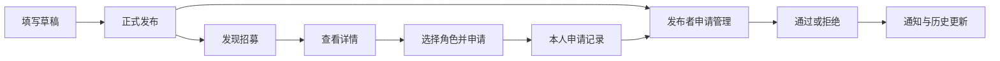

# 页面与交互设计

更新日期为 2026 年 11 月 16 日。完整页面方案和首轮 8 个核心页面已合并到本文。

## 交互综述

平台围绕发现机会、理解要求、发布招募、申请参与、审核和沟通组织页面。课程、乐队、游戏、问卷与志愿服务共用招募角色和名额模型。

页面沿用紫色、浅背景、白色卡片和状态标签。桌面以顶部导航、内容区和辅助侧栏呈现，手机使用底部主导航、单栏详情及列表/会话分屏。表单按基本信息、岗位、时间地点与标签、自定义信息组织。

## 当前导航

```text
发现组队 → 招募详情 → 岗位选择与申请
发布招募 → 自动/手动草稿 → 正式发布
找同学 → 公开主页 → 私信
消息入口 → 私信 / 系统通知
个人中心 → 资料 / 管理发布 / 当前申请 / 组队历史 / 收藏 / 设置
管理员入口 → 用户管理
```

## 核心页面

| 首轮编号 | 页面与当前 Hash 路由 | 已有交互 |
| --- | --- | --- |
| P01 | `/auth`、`/register`、`/verify`、`/forgot` | 登录、注册、验证码、密码重置，开发模式显示验证码 |
| P02 | `/discover` | 关键词、分类、精确标签与排序，搜索结果按相关度排序展示 |
| P03 | `/detail/:id` | 活动说明、角色、公开补充信息与附件，申请弹窗、收藏、私信 |
| P04 | `/publish`、`/edit/:id` | 自动/手动草稿、多岗位、名额与截止约束、自定义信息和附件 |
| P05 | `/posts`、`/drafts` | 查看发布、继续编辑、复制新草稿、条件删除、提前结束 |
| P06 | `/posts/:id/applications` | 申请资料、通过拒绝、撤销和操作历史 |
| P07 | `/applications` | 本人状态、原因、历史、撤回与放弃 |
| P08 | `/profile`、`/favorites`、`/teams`、`/settings` | 资料头像、收藏、组队历史、隐私、注销 |

## 扩展页面

| 页面 | 当前状态 | 后续内容 |
| --- | --- | --- |
| `/people`、`/person/:id` | 已有 | 搜索分页、隐私与关联历史口径完善 |
| `/chats?peer=:id` | 已有基础会话 | 个人删除隐藏、黑名单、消息举报、链接分享 |
| `/notices` | 已有通知及全部已读 | 治理结果通知、类型与分页 |
| `/admin` | 已有用户管理 | 操作历史的可见查询及治理联动 |
| 招募管理后台 | 待开发 | 独立下架、恢复、原因与记录 |
| 举报管理后台 | 待开发 | 核实、驳回、处罚编排及安全通知 |
| 分类标签后台 | 待开发 | 维护、合并及引用影响 |
| 私信管理与访问审计 | 待开发 | 填原因、审计成功、只读正文、访问记录 |
| 黑名单设置 | 待开发 | 列表、拉黑解除、影响确认 |

后台仍按用户、招募、举报、分类标签、私信五类业务组织，审计嵌入相关业务页面。

## 主要操作流程



招募详情的参与按钮打开岗位选择，再进入留言、经历和作品链接表单。本人招募展示管理入口。登录后返回原入口，认证状态由服务端检查。

发布时支持最多 20 项自定义信息，属性为文字、网址或附件。上传后展示文件状态，草稿保留引用，发布后可在详情下载。当前旧字段兼容编辑仍保留于已有数据的表单中。

## 异常与关键反馈

- 列表区分加载、无数据、搜索无结果和失败重试。
- 草稿展示自动保存中、成功、失败及手动重试。
- 表单校验字段，上传校验格式和大小，失败保留可恢复输入。
- 审核检查最新状态，名额已满、截止和已处理时显示具体错误。
- 结束、删除、拒绝、撤销、撤回、放弃和注销提供明确确认。
- 私信展示加载、无消息、发送或刷新失败和重试，消息个人删除隐藏仍待开发。
- 管理私信的正文必须在原因与审计成功后才展示，此流程待开发。

## 原型与实现

可点击的 [完整静态原型](../static-page-complete/dist/index.html) 用于展示页面和模拟状态。实际功能进度以 React 页面、FastAPI 接口和数据库链路核对，见 [功能进展](02-requirements.md)。

旧页面方案引用的外部 Word 附件在当前仓库中缺失，本文已移除失效依赖。当前交互可直接查看运行应用及仓库内静态原型。
