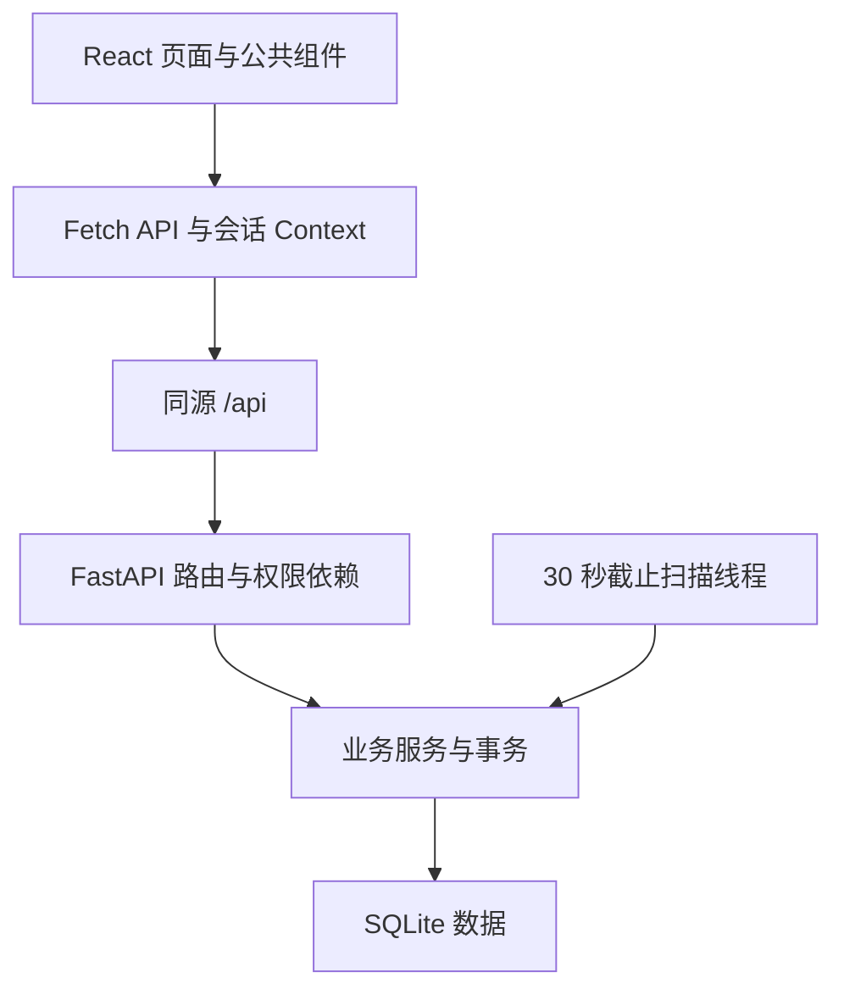

# 当前架构与账号模块实现

核对日期为 2026 年 11 月 16 日。原 A 模块实现规格已合并到本文。

## 技术栈与代码分层

| 部分 | 当前技术 | 职责 |
| --- | --- | --- |
| 前端 | React 19、TypeScript、Vite、React Router | 页面、公共组件、Hash 路由与生产构建 |
| 后端 | Python 3.10+、FastAPI、Pydantic、Uvicorn | API、输入校验、权限、业务与截止扫描 |
| 数据 | SQLite、原生 sqlite3 | 外键、事务、申请唯一约束、附件 BLOB |
| 验证 | pytest、HTTPX、Playwright | 后端测试、浏览器流程和类型构建检查 |

本机配置采用 Python 3.12、Node.js 22.22.0。数据库实际仍为 SQLite，MySQL 尚未迁移。

前端类型位于 `frontend/src/types.ts`，请求位于 `api.ts`，会话由 `context.tsx` 管理。Cookie 保存会话令牌，localStorage 只写身份变化版本标记以同步标签页。

路由位于 `backend/app/routers/`，申请状态操作集中于 `services.py`。数据库连接和事务位于 `db.py`，原生 SQL 使用参数绑定。当前没有独立 ORM 或 Repository 层。

## 数据实体与迁移

| 数据 | 表及用途 |
| --- | --- |
| 账号 | `users`、`sessions`、`login_attempts`、`email_codes` |
| 招募 | `categories`、`posts`、`roles`、`drafts`、`attachments`、`favorites` |
| 匹配 | `applications`、`application_events` |
| 交流 | `messages`、`notices` |
| 用户处罚 | `admin_actions`，仅 ban/unban 操作 |
| 模式版本 | `schema_version`，当前为 2 |

启动时初始化表结构，并按现有列进行幂等增量迁移。已处理用户管理、头像和注销字段，岗位 `accepting`、招募 `updated_at`、旧单附件索引等兼容。版本标记清理旧值后保留 2。完整的有序迁移框架仍待建设。

黑名单、举报、私信访问审计、个人消息删除及会话隐藏尚无对应表结构。`admin_actions` 不能替代私信访问审计，因为它只记录用户封禁与解封。

## 连接、事务与截止

- SQLite 启用外键、WAL 和 15 秒 busy timeout。
- `get_db_reader` 为认证单次查询提供连接。
- `get_db_readonly` 通常开启普通读事务，遇到实际到期招募时在写锁内补处理到期，再读取。
- `get_db` 使用进程内 `WRITE_LOCK` 和 `BEGIN IMMEDIATE` 串行化写事务，提交或回滚整个请求。
- 业务写入前处理截止，后台线程每 30 秒补扫描，退出时等待线程结束。
- 部分唯一索引保证同用户同岗仅一条待审、同招募仅一条通过。

当前适用于单实例部署。跨进程的容量保护还依赖 SQLite 事务和唯一约束，进程内锁只覆盖当前进程。多实例任务调度、完整迁移工具和生产部署监控继续完善。

## A 模块接口与页面

| 能力 | API | 页面或入口 |
| --- | --- | --- |
| 注册 | `POST /api/auth/register` | `/register` |
| 登录退出和资料 | `/api/auth/login`、`/logout`、`/me` | `/auth`、个人中心 |
| 认证发码和校验 | `POST /api/auth/verify/send`、`/verify/check` | `/verify` |
| 找回密码 | `POST /api/auth/reset/request`、`/reset/confirm` | `/forgot` |
| 头像上传删除 | `POST/DELETE /api/auth/avatar` | `/profile` |
| 头像读取 | `GET /api/users/{user_id}/avatar` | 公共 Avatar 组件 |
| 注销 | `POST /api/auth/delete` | `/settings` 确认与密码输入 |
| 用户检索 | `GET /api/admin/users` | `/admin` |
| 封禁解封 | `POST /api/admin/users/{id}/ban`、`/unban` | 用户管理确认弹窗 |

以上接口前缀省略形式均相对于 `/api/auth`。账号代码位于 `routers/account.py`、`routers/auth.py`、`auth.py` 和 `emailing.py`，管理代码位于 `routers/admin.py`。

### 认证与会话

密码采用随机盐 PBKDF2-HMAC-SHA256，迭代 600,000 次。会话随机令牌在库中存散列，Cookie 设置 HttpOnly、SameSite=Lax，有效期 7 天，HTTPS 环境通过 `COOKIE_SECURE=1` 开启 Secure。

验证码为 6 位数字，10 分钟有效，每码最多错误 5 次，同邮箱同用途按当前未消费记录判断 60 秒冷却。数据库保存散列。SMTP 代码当前使用 STARTTLS，真实发信待配置验证。本地 `SMTP_ENABLED=0` 返回并展示开发验证码。

中间件检查写入来源与请求格式，允许 JSON 和 multipart。头像采用 multipart，其他业务按各接口实际校验处理。

### 头像与注销

头像支持 PNG、JPEG、WEBP、GIF，最大 2 MB，校验 MIME 与文件头，由服务端生成名称，实际目录为 `backend/app/static/avatars/`。

注销检查密码，匿名化资料、释放原邮箱、清空公开标志、删除会话和头像。原邮箱可注册新账号。头像文件操作和数据库事务尚未形成跨存储原子提交机制，活动招募和申请的注销处理也待补齐。

### 用户管理

管理员可检索用户、按封禁状态筛选、封禁解封。封禁原因必填，禁止封禁本人及其他管理员，数据库追加 `admin_actions` 并生成通知。当前页面和接口未提供处罚历史查询，完整招募可见性联动及跨模块治理仍需完善。

## 招募与消息实现边界

进行中的招募支持岗位和名额修改、截止延长与安排变更，相关申请者收到通知。补充信息支持最多 20 项自定义内容和多附件，每个附件最大 5 MB，格式包含 PDF、DOCX、PNG、JPG、TXT。附件以 BLOB 存数据库，公开详情提供下载，编辑保留兼容旧记录。

基础私信和通知可用，消息按游标拉取，导航约 10 秒刷新未读。系统通知直接在业务事务中插入，尚无通用事件去重、投递队列或举报处理记录。链接分享、个人删除隐藏及私信管理审计见 [功能进展](02-requirements.md)。

## 配置、运行与验证

后端启动时读取当前目录 `.env`，shell 环境变量优先，模板为 `backend/.env.example`。开发服务使用 8000 和 5173，浏览器测试使用 8001 和 5174 及临时数据库。

已有 18 项后端测试与 3 项浏览器测试，上次环境配置时全部通过。账号认证、重置、注销和管理员权限另做过临时数据库检查，真实 SMTP 尚待验证。本次文档整理执行文档一致性检查，测试命令见 [本地指南](local-testing.md)。
