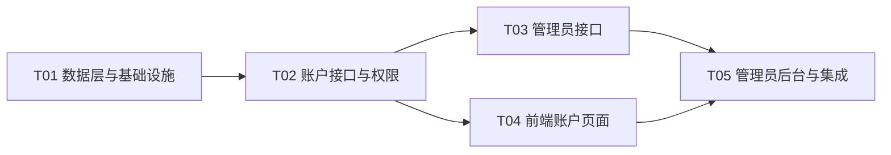
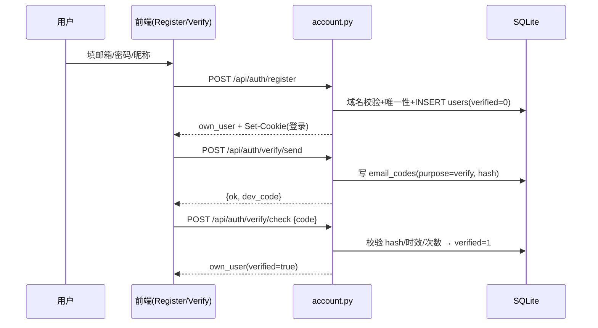
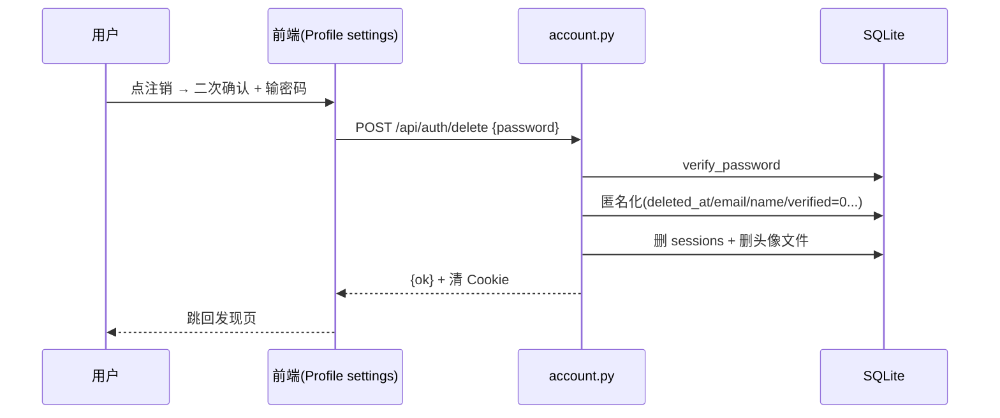

# A 模块实现规格：账号与用户功能完善与延展

版本：1.0｜作者：架构师 高见远（Gao）｜分支：`hyl`｜技术栈：FastAPI + SQLite（原生 sqlite3）+ React 19 + TS + Vite + HashRouter + 手写 fetch

> 本文只覆盖**账号 / 用户 / 认证 / 头像 / 注销 / 管理员**相关文件。B（消息与治理）、C（招募与发现）、D（申请与匹配）由其他组员开发，本文**不修改** `routers/recruitment.py`、`services.py` 以及招募/申请/私信相关前端页面。跨模块边界在第 7 节明确列出。

---

## 1. 现状与缺口对照表

| 子功能 | 需求 | 现状 | 现有落点（文件） | 本次动作 |
| --- | --- | --- | --- | --- |
| 登录 / 退出 | F-02 | ✅ 已做 | `backend/app/routers/auth.py`：`/api/auth/login`、`/api/auth/logout` | 仅补「注销账号拒绝登录」判断 |
| 个人资料编辑 | F-05 | ✅ 已做 | `PATCH /api/auth/me`（昵称/院系/年级/简介/标签） | 新增头像字段 `avatar_url` |
| 找同学（搜索） | F-08 | ✅ 已做 | `backend/app/routers/community.py`：`/api/people`、`/people/{id}` | 头像展示（可选增强） |
| 隐私三开关 | F-06 | ✅ 已做 | `searchable / public_posts / public_teams`，`PATCH /me` | 注销时强制全部关闭 |
| 注册 | F-01 | ❌ 缺失 | 无 register 接口；`frontend/src/pages/Auth.tsx` 写「注册尚未开放」 | **新增** |
| 校园邮箱认证 | F-03 | ❌ 缺失 | 种子账号直接 `verified=1`，无验证码流程 | **新增** |
| 密码找回 | TD-01 内 | ❌ 缺失 | 无 | **新增** |
| 头像上传 | F-05 附 | ❌ 缺失 | 前端仅首字母头像（`name[0]`） | **新增** |
| 自主注销 | F-38 | ❌ 缺失 | 无 | **新增**（匿名化软删） |
| 后台用户管理（封禁/解封） | F-35 | ❌ 缺失 | 无 `is_admin`、无 admin 路由/页面 | **新增** |

---

## 2. 数据模型变更（schema.sql + 迁移方式）

当前库初始化方式是 `db.init_db()` → `db.executescript(schema.sql)`，`schema.sql` 内是 `CREATE TABLE IF NOT EXISTS` + `schema_version`（当前 `version=1`），**没有 Alembic**。

增量原则：**只增不改**。不重命名、不删列、不改既有列类型；新增列带 `DEFAULT`；新表用 `CREATE TABLE IF NOT EXISTS`。这样不会破坏 B/C/D 正在使用的表结构，也不破坏现有 `backend/data/campuscrew.sqlite3` 数据。

### 2.1 `users` 表新增 3 个字段

```sql
avatar_path TEXT NOT NULL DEFAULT ''   -- 头像文件名（不含目录），空串=无头像
is_admin    INTEGER NOT NULL DEFAULT 0 -- 0=普通用户 1=管理员；无注册成管理员通道
deleted_at  TEXT                        -- NULL=正常；ISO 时间=已注销（匿名化软删标记）
```

### 2.2 新增 2 张表

```sql
CREATE TABLE IF NOT EXISTS email_codes(
  id         INTEGER PRIMARY KEY,
  email      TEXT NOT NULL,
  purpose    TEXT NOT NULL CHECK(purpose IN ('verify','reset')),
  code_hash  TEXT NOT NULL,               -- sha256(6位数字码)，绝不存明文
  user_id    INTEGER REFERENCES users(id) ON DELETE CASCADE,
  expires_at TEXT NOT NULL,               -- 有效期 10 分钟
  attempts   INTEGER NOT NULL DEFAULT 0,  -- 已错误尝试次数
  consumed   INTEGER NOT NULL DEFAULT 0,  -- 0=未用 1=已用
  created_at TEXT NOT NULL
);
CREATE INDEX IF NOT EXISTS email_code_lookup
  ON email_codes(email, purpose, consumed);

CREATE TABLE IF NOT EXISTS admin_actions(
  id             INTEGER PRIMARY KEY,
  admin_id       INTEGER NOT NULL REFERENCES users(id),  -- 操作管理员
  target_user_id INTEGER NOT NULL REFERENCES users(id),  -- 被处理用户
  action         TEXT NOT NULL CHECK(action IN ('ban','unban')),
  reason         TEXT NOT NULL DEFAULT '',
  created_at     TEXT NOT NULL
);
```

### 2.3 迁移方式（关键：不破坏现有数据）

`schema.sql` 的 `users` 建表语句**同时**写入上述 3 个新字段（供全新数据库），并把 `INSERT OR IGNORE INTO schema_version VALUES(1)` 改为 `VALUES(2)`。

在 `backend/app/db.py` 的 `init_db()` 里，`executescript` 之后追加一个幂等的 `migrate(db)`：

```python
def migrate(db):
    existing = {r["name"] for r in db.execute("PRAGMA table_info(users)")}
    if "is_admin" not in existing:
        db.execute("ALTER TABLE users ADD COLUMN is_admin INTEGER NOT NULL DEFAULT 0")
    if "avatar_path" not in existing:
        db.execute("ALTER TABLE users ADD COLUMN avatar_path TEXT NOT NULL DEFAULT ''")
    if "deleted_at" not in existing:
        db.execute("ALTER TABLE users ADD COLUMN deleted_at TEXT")
    db.execute("UPDATE schema_version SET version=2 WHERE version<2")
    db.commit()
```

要点：
- `email_codes`、`admin_actions` 用 `CREATE TABLE IF NOT EXISTS`，**新旧库都会自动创建**，无需版本门控。
- 只有 `ALTER TABLE ADD COLUMN` 需要版本/PRAGMA 防护（`ALTER ADD COLUMN` 重复执行会报错），用 `PRAGMA table_info` 判断缺失再补列，**幂等且自愈**。
- 全新库：`schema.sql` 直接建出含新列的 `users`（version=2），`migrate` 跳过。
- 老库：`CREATE TABLE IF NOT EXISTS users` 不动旧表 → `migrate` 用 `ALTER` 补列 → `version=2`。

---

## 3. 后端接口清单

沿用现有 `{detail: "..."}` 错误格式、`HTTPException(status, detail)` 风格、`get_db` 事务、`now()` ISO 时间。

### 3.1 新文件组织

| 文件 | 职责 |
| --- | --- |
| `backend/app/emailing.py`（新） | 校园邮箱域名校验、6 位码生成/哈希、开发态直通（打日志/返回 dev_code）、预留 SMTP |
| `backend/app/routers/account.py`（新） | 注册、校园认证、密码找回、头像上传/读取、注销 |
| `backend/app/routers/admin.py`（新） | 管理员用户列表 / 封禁 / 解封 |

### 3.2 账户接口（`account.py`，router 前缀 `"/api"`，tags=`["账户"]`）

#### ① 注册 `POST /api/auth/register`（公开）
- 请求体：`{"email": "xx@mails.tsinghua.edu.cn", "password": "≥8位", "name": "昵称"}`
- 响应：`201` 返回 `own_user`（与登录一致），并 `Set-Cookie campus_session`（注册即登录）。
- 行为：
  1. `email = email.lower().strip()`；校验 `emailing.is_campus_email(email)`，非法域名 → `422 "仅支持校园邮箱注册"`。
  2. 唯一性：`INSERT`，捕获 `sqlite3.IntegrityError`（UNIQUE 冲突，覆盖并发注册）→ `409 "该邮箱已注册"`。
  3. `hash_password` 存密码；`verified=0`（未认证，不能发布/申请/私信，由现有 `student` 依赖自动保证）。
  4. 创建 session + cookie（复用 `login` 的 session 逻辑，可抽一个小函数）。

#### ② 发送校园认证码 `POST /api/auth/verify/send`（登录即可，`current_user`）
- 请求体：无（用当前 `user["email"]`）。
- 响应：`{"ok": true, "dev_code": "123456"}`（仅 `SMTP_ENABLED=0` 时含 `dev_code`）。
- 行为：已 `verified` → `409 "已完成校园认证"`；60 秒内重复发 → `429 "请稍后再试"`；生成 6 位数字码，`code_hash=sha256(code)`，写 `email_codes(purpose='verify', user_id=当前id)`；`emailing.send_code(...)`。

#### ③ 校验校园认证码 `POST /api/auth/verify/check`（登录即可，`current_user`）
- 请求体：`{"code": "123456"}`。
- 响应：`own_user`（`verified` 已置 1）。
- 行为：校验码（见 3.5 校验规则）；成功 → `UPDATE users SET verified=1`，`consumed=1`；封禁用户 → `403 "账号当前只读"`。

#### ④ 发送重置码 `POST /api/auth/reset/request`（公开）
- 请求体：`{"email": "..."}`。
- 响应：`{"ok": true, "dev_code": "..."}`；**邮箱不存在也返回 200**（防枚举，但不发码、`dev_code` 为空）。
- 行为：查 `users`；存在 → 60s 冷却 → 生成码写 `email_codes(purpose='reset')` 并发送。

#### ⑤ 重置密码 `POST /api/auth/reset/confirm`（公开）
- 请求体：`{"email": "...", "code": "123456", "password": "≥8位"}`。
- 响应：`{"ok": true}`。
- 行为：校验码；成功 → `UPDATE users SET password_hash=?`；`DELETE FROM sessions WHERE user_id=?`（使旧会话全部失效）。

#### ⑥ 上传头像 `POST /api/auth/avatar`（`student`：认证且非封禁）
- 请求体：`multipart/form-data`，字段名 `file`。
- 响应：`own_user`（`avatar_url` 已更新）。
- 行为：见 7.2 头像安全校验；保存到 `backend/static/avatars/{user_id}-{时间戳}.{ext}`；删除旧文件；`UPDATE users SET avatar_path=?`。

#### ⑦ 读取头像 `GET /api/users/{user_id}/avatar`（公开）
- 响应：图片 `FileResponse`；无头像或用户已注销 → `404`。
- 行为：查 `users.avatar_path`；拼绝对路径返回。头像属公开资料（访客看发布者头像），故不鉴权。

#### ⑧ 注销 `POST /api/auth/delete`（登录即可，`current_user`；封禁用户也允许，见 TD-05）
- 请求体：`{"password": "..."}`（身份验证；二次确认由前端完成）。
- 响应：`{"ok": true}`。
- 行为：`verify_password` 失败 → `401 "密码错误"`；成功则**匿名化软删**：
  1. `deleted_at = now()`
  2. `email = "deleted+{id}@deleted.invalid"`（释放原校园邮箱，见 7.5）
  3. `password_hash = hash_password(secrets.token_urlsafe(32))`
  4. `name = "已注销用户"`，`dept/year/bio=''`，`tags='[]'`
  5. `verified=0, banned=0, searchable=0, public_posts=0, public_teams=0, avatar_path=''`
  6. 删除头像文件；`DELETE FROM sessions WHERE user_id=?`；`response.delete_cookie("campus_session")`

### 3.3 管理员接口（`admin.py`，router 前缀 `"/api/admin"`，tags=`["管理"]`）

#### ⑨ 用户列表 `GET /api/admin/users`（`admin`）
- Query：`q`（昵称/邮箱模糊）、`banned`（`''`=全部 / `'0'` / `'1'`）、`limit`（≤100，默认 100）、`offset`。
- 响应：`[{"id","email","name","dept","year","verified","banned","is_admin","avatar_url"}]`。
- 行为：`WHERE (q='' OR instr(name,q)>0 OR instr(email,q)>0) AND (?='' OR banned=?)`，按 `id` 排序。

#### ⑩ 封禁 `POST /api/admin/users/{user_id}/ban`（`admin`）
- 请求体：`{"reason": "..."}`（必填，1–1000 字符）。
- 响应：`{"ok": true}`。
- 行为：目标存在；**不能封禁自己** → `409`；**不能封禁其他管理员** → `403 "不能封禁管理员账号"`；`UPDATE users SET banned=1`；写 `admin_actions(action='ban', reason)`；`notify(db, target, "你的账号已被封禁。", None)`。

#### ⑪ 解封 `POST /api/admin/users/{user_id}/unban`（`admin`）
- 请求体：`{"reason": ""}`（可选）。
- 响应：`{"ok": true}`。
- 行为：`UPDATE users SET banned=0`；写 `admin_actions(action='unban')`；`notify(db, target, "你的账号已解封。", None)`。

> 封禁/解封只需翻转 `banned` 标志——现有 `recruitment.py` 的 `/posts` 已 `u.banned=0` 过滤、`detail` 已查 banned、`student` 依赖已拒封禁写入，因此**无需改动 C/D 模块**即自动实现「封禁只读 + 隐藏活动招募 + 解封恢复」。

### 3.4 `auth.py` 修改点（账号模块自身文件）

- `optional_user` 查询追加 `AND u.deleted_at IS NULL`（注销者残留会话立即失效）。
- `login` 在查到 `user` 后追加 `if user["deleted_at"]: raise HTTPException(401, "该账号已注销")`。
- `own_user` 增加键：`is_admin`、`avatar_url`；`public_user` 增加键：`avatar_url`（追加键，不改/不删既有键，前端安全）。
  - `avatar_url = f"/api/users/{user['id']}/avatar" if user["avatar_path"] else None`
- 新增依赖：
  ```python
  def admin(user=Depends(current_user)):
      if not user["is_admin"]:
          raise HTTPException(403, "需要管理员权限")
      if user["banned"]:
          raise HTTPException(403, "管理员账号当前只读")
      return user
  ```

### 3.5 验证码规则（`emailing.py` + `account.py` 共用）

- 6 位数字，`secrets.randbelow(1_000_000)` 补零；**DB 只存 `sha256(code)`**（NFR-02）。
- 有效期 10 分钟；单码最多错 5 次；同 `email+purpose` 60 秒内只发一次。
- 校验流程：取最新未用未过期码 → 无/过期 → `410 "验证码已过期，请重新获取"`；`attempts>=5` → `429 "尝试次数过多，请重新获取"`；hash 不匹配 → `attempts+1`，`400 "验证码错误"`；匹配 → `consumed=1`。

### 3.6 `emailing.py` 接口（开发态直通 + 预留 SMTP）

```python
CAMPUS_DOMAINS = os.getenv("ALLOWED_EMAIL_DOMAINS",
    "mails.tsinghua.edu.cn,tsinghua.edu.cn").split(",")
SMTP_ENABLED = os.getenv("SMTP_ENABLED", "0") == "1"

def is_campus_email(email: str) -> bool      # 域名白名单
def make_code() -> str                        # 6 位数字
def hash_code(code: str) -> str               # sha256 hex
def send_code(email: str, code: str, purpose: str) -> None:
    if SMTP_ENABLED:
        # 预留：smtplib 发信（SMTP_HOST/PORT/USER/PASSWORD/MAIL_FROM）
        ...
    else:
        print(f"[DEV] {purpose} code for {email}: {code}")   # 打到后端日志
```
开发态由接口把 `dev_code` 随响应返回，前端直接展示，方便无邮件环境联调。

---

## 4. 权限设计（is_admin 与依赖链）

系统角色只有「普通用户 / 管理员」两种；管理员的管理资格与学生业务资格**分别校验**（TD-08）。依赖链沿用现有风格：

```
optional_user  →  未登录返回 None；追加 deleted_at 过滤
current_user   →  未登录 401 "请先登录"
student        →  未认证 403 "请先完成校园认证" / 封禁 403 "账号当前只读"   （现有，不动）
admin          →  is_admin=0 → 403 "需要管理员权限"；banned=1 → 403 "管理员账号当前只读"
```

- 普通用户权限零变化：`is_admin` 默认 0，`student`/`current_user` 行为不变。
- 管理员不能封禁自己、不能封禁其他管理员（保护种子管理员）。
- 管理员是否兼有普通学生业务，取决于其 `verified`/`banned`（与普通用户一致），管理接口只认 `admin` 依赖，不要求 `verified`。
- `seed.py` 提权：`ADMIN_EMAIL = os.getenv("ADMIN_EMAIL", "lin@example.test")`，在 `seed()` 里**无论新库还是老库**都执行 `UPDATE users SET is_admin=1 WHERE email=?`（幂等），保证开发库始终有管理员；无任何「注册即管理员」通道。

---

## 5. 前端页面与路由

沿用手写 fetch（`api.ts`）+ HashRouter + `SessionProvider`。新增/修改如下：

| 文件 | 动作 | 内容 |
| --- | --- | --- |
| `frontend/src/types.ts` | 改 | `Person` 加 `avatar_url?: string \| null`；`User` 加 `is_admin: boolean`、`avatar_url?: string \| null` |
| `frontend/src/api.ts` | 改 | 新增 `uploadAvatar(file: File): Promise<User>`（`FormData` + `fetch('/api/auth/avatar', {method:'POST', credentials:'same-origin', body:form})`，复用 `ApiError` 处理，**不设 JSON Content-Type**） |
| `frontend/src/components/ui.tsx` | 改 | 新增 `<Avatar name url className/>`：有 `url` 渲染 ``，否则回退首字母 `<span>` |
| `frontend/src/pages/Register.tsx` | 新 | 邮箱/密码/昵称 → `POST /auth/register` → `setUser` → 跳 `/verify` |
| `frontend/src/pages/Verify.tsx` | 新 | 校园认证：发码（dev 显示 `dev_code`）+ 输码校验 → 刷新 `user` |
| `frontend/src/pages/Forgot.tsx` | 新 | 找回密码：发重置码 → 输码 + 新密码 → 跳 `/auth` |
| `frontend/src/pages/Admin.tsx` | 新 | 后台：用户列表 + 搜索 + 封禁/解封（封禁弹原因） |
| `frontend/src/pages/Auth.tsx` | 改 | 加「注册账号」「忘记密码」链接；删除「尚未开放」文案 |
| `frontend/src/pages/Profile.tsx` | 改 | 资料态：头像上传（file input + 预览 + `uploadAvatar`）；设置态：注销入口（二次确认 Modal + 密码输入） |
| `frontend/src/pages/People.tsx` | 改（可选） | 用 `<Avatar>` 展示真实头像 |
| `frontend/src/App.tsx` | 改 | 新增路由 `/register`、`/forgot`、`/verify`（`<Guard>`）、`/admin`（`<Guard>`） |
| `frontend/src/components/Layout.tsx` | 改 | 账号区头像用 `<Avatar>`；`user.is_admin` 时在个人侧边栏/导航显示「后台管理」入口 |

路由规划（HashRouter）：

```
/register      Register      （公开）
/forgot        Forgot        （公开）
/verify        Guard > Verify（登录即可，未认证用户使用）
/admin         Guard > Admin （登录后，Admin 内自检 is_admin，非管理员显示无权）
```

管理员后台页内部逻辑：`useSession().user.is_admin === false` → 渲染 `Empty("需要管理员权限")`；前端禁用只是辅助，后端 `admin` 依赖才是真正闸门（NFR-01）。

---

## 6. 任务分解（有序，含依赖）

按「后端数据层 → 后端接口 → 前端页面 → 联调」划分，工程师可直接照做。

### T01 后端数据层与基础设施
- **文件**：
  - 改 `backend/app/schema.sql`（users 加 3 列 + 2 张新表 + version=2）
  - 改 `backend/app/db.py`（`init_db` 里加 `migrate()`）
  - 新 `backend/app/emailing.py`（域名校验/验证码/SMTP 预留）
  - 改 `backend/app/seed.py`（`ADMIN_EMAIL` 提权，幂等）
  - 改 `backend/.env.example`（补 `ALLOWED_EMAIL_DOMAINS`、`SMTP_ENABLED`、`ADMIN_EMAIL`）
- **依赖**：无
- **验收**：老库执行后 `PRAGMA table_info(users)` 含 `is_admin/avatar_path/deleted_at`；`email_codes`、`admin_actions` 存在；`schema_version=2`；种子后 `lin@example.test` 为管理员。

### T02 后端账户接口 + 权限扩展
- **文件**：
  - 改 `backend/app/auth.py`（`admin` 依赖、`own_user/public_user` 加 `avatar_url/is_admin`、`optional_user` 过滤 `deleted_at`）
  - 改 `backend/app/schemas.py`（`Register/VerifyCode/ResetRequest/ResetPassword/DeleteAccount`）
  - 新 `backend/app/routers/account.py`（注册/认证/重置/头像/注销）
  - 改 `backend/app/routers/auth.py`（`login` 拒注销账号）
  - 改 `backend/app/main.py`（挂载 account 路由 + 放行 multipart，见 7.2）
- **依赖**：T01
- **验收**：注册→认证→登录→找回→头像→注销全链路可用；注销账号再登录被 401；未认证账号发帖/申请/私信被 `student` 拦截。

### T03 后端管理员接口
- **文件**：
  - 新 `backend/app/routers/admin.py`（列表/封禁/解封）
  - 改 `backend/app/schemas.py`（`BanUser/UnbanUser`）
  - 改 `backend/app/main.py`（挂载 admin 路由）
- **依赖**：T02（用 `admin` 依赖）
- **验收**：普通用户访问 `/api/admin/*` 全 403；封禁后该用户登录只读、活动招募从发现页消失（复用现有 banned 过滤）；`admin_actions` 有记录、被处理者收到通知。

### T04 前端账户页面
- **文件**：
  - 改 `frontend/src/types.ts`、`frontend/src/api.ts`、`frontend/src/components/ui.tsx`
  - 新 `frontend/src/pages/Register.tsx`、`Verify.tsx`、`Forgot.tsx`
  - 改 `frontend/src/pages/Auth.tsx`、`Profile.tsx`（头像上传 + 注销入口）
  - 改 `frontend/src/App.tsx`（新增 3 条路由）
- **依赖**：T02（接口就绪后可联调）
- **验收**：注册→认证引导闭环；找回密码可用；头像上传/预览/展示；注销二次确认 + 密码校验后退出。

### T05 前端管理员后台 + 路由集成 + 联调
- **文件**：
  - 新 `frontend/src/pages/Admin.tsx`
  - 改 `frontend/src/App.tsx`（`/admin` 路由）
  - 改 `frontend/src/components/Layout.tsx`（管理员入口 + 头像）
  - 改 `frontend/src/pages/People.tsx`（头像展示，可选）
- **依赖**：T03、T04
- **验收**：管理员可见后台入口并封禁/解封；普通用户无入口、直接访问 `/admin` 被提示无权；全流程 `npm run build` + 手工/浏览器联调通过。

任务依赖图：



---

## 7. 关键风险与边界

### 7.1 未认证用户权限（注册后、认证前）
注册即登录，但 `verified=0`。现有 `student` 依赖已要求 `verified`，故未认证用户**不能发布/申请/私信**（BR-03），但能登录、编辑资料（`PATCH /me` 用 `student` 会拦截未认证用户改资料，此处需注意）。

> ⚠️ 设计取舍：现有 `PATCH /me` 依赖 `student`，导致**未认证用户连昵称都改不了**。而注册时昵称已必填，通常无需再改；若产品要求未认证也能改基础资料，需把 `PATCH /me` 拆成「基础资料（登录即可）」与「隐私开关（认证后）」。**本次为最小改动**：保持 `PATCH /me` 用 `student` 不变（未认证只读个人中心，引导去 `/verify`），如需放开请与产品确认。

### 7.2 头像上传的安全与 multipart 放行（坑 ①）
- 校验：`content-type ∈ {image/png, image/jpeg, image/webp, image/gif}`；大小 ≤ 2MB；**魔数校验**（PNG `\x89PNG`、JPEG `\xff\xd8\xff`、GIF `GIF87a/GIF89a`、WEBP `RIFF....WEBP`）；文件名由服务端生成 `{user_id}-{ts}.{ext}`，**不使用用户原始文件名**，杜绝路径穿越。
- 存储：`backend/static/avatars/`（代码里 `Path(__file__).resolve().parents[1] / "static" / "avatars"`，启动时 `mkdir(parents=True, exist_ok=True)`）。
- **坑**：`main.py` 的 `same_origin_writes` 中间件现在对 `POST/PUT/PATCH` 强制 `application/json`，会 415 掉 multipart 头像上传。必须放行：
  ```python
  ct = request.headers.get("content-type", "")
  if request.method in ("POST","PUT","PATCH") and "application/json" not in ct \
     and not ct.startswith("multipart/form-data"):
      return JSONResponse({"detail": "请使用 JSON 请求"}, status_code=415)
  ```
  此改动是**加性**的（JSON 请求仍严格校验），不影响 B/C/D。

### 7.3 验证码时效与频率
10 分钟过期、单码 5 次错误上限、同邮箱同用途 60 秒冷却；明文只存日志/`dev_code`，DB 存 `sha256`。生产 `SMTP_ENABLED=1` 时不返回 `dev_code`。

### 7.4 注销：匿名化 vs 物理删（保守方案，TD-05）
采用**匿名化软删**，不物理删除、不级联删业务数据（保护 FKs 与 B/C/D 历史）。账号无法登录/写入（`deleted_at` 过滤 + `verified=0` + session 全删）。这是对 TD-05 的保守落地方案，不冒充「法定期限删除」承诺。

**跨模块协调点（A 模块只做账号自身处理）：**
| 事项 | 归属 | 现状 / 建议 |
| --- | --- | --- |
| 注销者活动招募的隐藏 | C（recruitment.py） | `posts`/`detail` 需追加 `u.deleted_at IS NULL`；本次不动 |
| 注销者 pending/accepted 申请的终态 | D（services.py） | 待 D 负责人设计；本次不代为实现 |
| 注销后私信不可达 | B | 已天然满足：`send_message` 检查 `verified=1 AND banned=0`，注销者 `verified=0` |
| 注销对举报/审计的保留 | B/D（治理） | 待协调 |

### 7.5 注销后原邮箱再注册（TD-05）
匿名化把 `email` 改为 `deleted+{id}@deleted.invalid`，**释放原校园邮箱 UNIQUE 约束**，原邮箱可再次注册为新账号（与旧账号无关联）。若产品要求「禁止复用」，需另建 `recycled_emails` 黑名单表——本次不实现，留待确认。

### 7.6 不破坏 B/C/D 模块的铁律自检
- **只增不改**：新列带默认值、新表 `IF NOT EXISTS`、`own_user/public_user` 只追加键，不删不重命名既有键（React 对未知字段免疫）。
- **零触碰清单**：`routers/recruitment.py`、`services.py`、`components/PostCard.tsx`、`pages/Discover|Detail|Publish|Manage|Messages` 均不改。
- **加性中间件改动**：仅放行 multipart，JSON 逻辑不变。
- **管理员不扩权**：`admin` 依赖只服务 `/api/admin/*`，不进入学生业务依赖链。
- **头像在招募卡片/访客发布者展示**：属 C 模块（`services.post_view` 的访客分支只返回 `{id,name}`，`PostCard` 只画首字母）。A 模块在 `public_user` 加 `avatar_url` 后，**已认证用户看到的发布者头像自动生效**；访客头像与卡片头像需 C 负责人协调（`post_view` 访客分支补 `avatar_url`）。

---

## 附：关键流程时序（Mermaid）

### 注册 → 校园认证



### 自主注销


