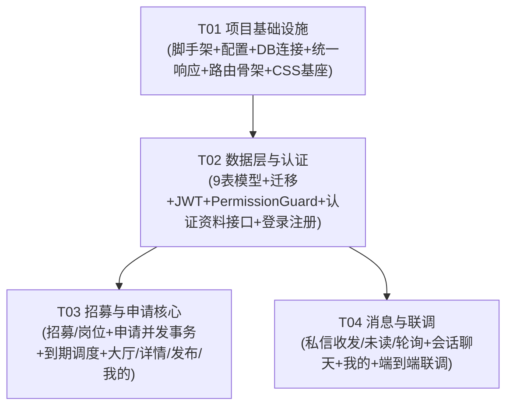

# CampusCrew 校园组队互助平台 — 可运行最小闭环 MVP 裁剪规格

版本：MVP-1.0｜作者：高见远（软件架构师）｜基线：`docs/system_design.md` v1.0 + `doc/00~03` 需求文档

> 本文是 **增量裁剪设计**，不推翻既有完整设计。目标：用最少的代码跑通一条端到端业务闭环，同时**完整落地核心业务不变量 BR-04/05/06/07**。凡本文未列的模块/字段/接口，一律按「MVP 不做」处理，留待后续按完整设计补齐。
>
> 技术栈已定：后端 FastAPI + SQLAlchemy 2.0（同步 Session）+ MySQL 8 + JWT；前端 React 18 + Vite + TypeScript + react-router-dom v6 + axios + zustand + @tanstack/react-query，**UI 使用轻量手写 CSS（不用 MUI）**，目录骨架借鉴参考项目 CampusHub。

---

## 0. MVP 范围与裁剪对照（一页看清）

| 模块 | 系统设计 | MVP 保留 | MVP 裁剪 |
| --- | --- | --- | --- |
| M1 认证 | F-01~04、F-38 | 注册 / 登录 / refresh / logout / me；JWT + `token_version`；`require_verified` 守卫 | 验证码发送/校验、找回密码（MVP **注册即认证**，见 §1.4） |
| M2 资料 | F-05~08 | `GET /auth/me` + `PUT /auth/me/profile`（昵称/院系/年级/简介） | 头像上传、隐私三开关、他人主页、用户搜索 |
| M3 招募 | F-09~14 | 草稿 / 直接发布 / 一般内容编辑 / 条件删除 / 手动结束 / 岗位增删(仅草稿) / 到期结束 | 一级分类 category、独立下架（治理） |
| M4 发现 | F-15~18 | 大厅列表（关键词+标签筛选、排序分页）、招募详情 | 收藏、组合筛选中的分类/地点维度 |
| M5 申请 | F-19~26 | 提交 / 通过 / 拒绝 / 撤回 / 放弃 / 撤销录取 + 并发联动（BR-04~07） | 「我的队伍」历史视图 |
| M6 消息 | F-27~31 | 一对一私信收发、会话列表、未读、标记已读、简化轮询 | 通知系统、个人侧删除、会话隐藏 |
| M7 治理 | F-32~37 | —（全部裁剪） | 管理后台五类、举报、黑名单、注销 |

**核心闭环一句话**：`注册/登录 → 发布招募(多岗位独立名额+截止) → 大厅筛选浏览 → 申请岗位 → 发布者通过/拒绝(并发安全) → 双方私信沟通 → 我的发布/我的申请查看`。

---

## 1. 实现方案

### 1.1 MVP 核心服务清单

| 服务 | 关键方法 | 职责 |
| --- | --- | --- |
| `AuthService` | `register` / `login` / `refresh` / `logout` / `get_me` / `update_profile` | 账号与会话；bcrypt + JWT；`token_version` 撤销 |
| `RecruitmentService` | `create` / `update` / `publish` / `delete_conditionally` / `end_manually` / `add_position` / `remove_position` / `list` / `get_detail` / `expire` | 招募生命周期、岗位名额、到期惰性检查 |
| `ApplicationService` | `submit` / `approve` / `reject` / `withdraw` / `abandon` / `revoke_offer` / `list_mine` / `list_for_recruitment` | 申请审核与**并发联动（核心事务）** |
| `MessageService` | `get_or_create_conversation` / `send` / `list_conversations` / `list_messages` / `mark_read` / `unread_count` | 一对一私信 + 未读游标 |
| `PermissionGuard`（`core/deps.py`） | `get_current_user` / `require_verified` / `require_owner` / `require_conversation_member` | 统一鉴权，所有端点复用 |

**分层**：`api(路由) → service(业务/事务) → models(ORM) → MySQL`；跨模块共享的权限判断收敛在 `deps.py`；满员/到期/结束联动**只**由 `ApplicationService`/`RecruitmentService` 计算，避免多模块各自算导致不一致。

### 1.2 并发设计：最后名额录取（BR-04/05/06/07 核心）

**串行化点**：`recruitments` 行级锁（`SELECT ... FOR UPDATE`）。录取、拒绝、撤回、放弃、撤销录取、手动结束、条件删除、提交申请全部共享同一条 `recruitments` 行锁边界，杜绝超额与中间态。

**双重保险**：行锁保证「事务内校验后写入」原子；生成列部分唯一索引保证「即使漏锁/锁外写入」也绝不会插入重复记录（兜底 BR-05）。

用 SQLAlchemy 2.0 同步 Session 实现 `approve`（最后名额录取）：

```python
from datetime import datetime, timezone
from sqlalchemy import select, update, func
from app.core.database import SessionLocal
from app.models import Recruitment, Position, Application, ApplicationHistory

def approve(self, operator_id: int, application_id: int) -> None:
    now = datetime.now(timezone.utc)
    with SessionLocal() as session:
        with session.begin():  # 事务边界
            # ① 先定位申请，拿到 recruitment_id（申请行可后锁）
            app = session.execute(
                select(Application).where(Application.id == application_id)
            ).scalar_one_or_none()
            if app is None:
                raise BizError(40400, "申请不存在")

            # ② 锁招募行 = 串行化点（后续所有校验都在锁内）
            rec = session.execute(
                select(Recruitment)
                .where(Recruitment.id == app.recruitment_id)
                .with_for_update()
            ).scalar_one()
            if rec.owner_id != operator_id:
                raise BizError(40300, "仅发布者可审核")

            # ③ 惰性到期：锁内复检 deadline（不能只靠调度器）
            if rec.status == "open" and rec.deadline_at <= now:
                self._expire_locked(session, rec, now)      # ended/expired + pending→expired
                raise BizError(40902, "招募已截止")

            if rec.status != "open":
                raise BizError(40902, "招募已结束")

            # ④ 申请行再锁 + 状态复检（禁止对已自动处理的申请二次通过）
            app = session.execute(
                select(Application).where(Application.id == application_id)
                .with_for_update()
            ).scalar_one()
            if app.status != "pending":
                raise BizError(40900, "该申请已处理")

            position = session.get(Position, app.position_id)

            # ⑤ BR-04 名额校验：锁内原子 count accepted < capacity
            accepted_cnt = session.execute(
                select(func.count())
                .select_from(Application)
                .where(Application.position_id == app.position_id,
                       Application.status == "accepted")
            ).scalar_one()
            if accepted_cnt >= position.capacity:
                raise BizError(40901, "岗位名额已满")

            # ⑥ 落库 accepted（生成列唯一索引兜底：同招募同用户仅一条 accepted）
            app.status = "accepted"
            app.reason = "approved"
            app.decided_at = now

            # ⑦ BR-06 顺序敏感：先撤回同人同招募其它 pending
            session.execute(update(Application).where(
                Application.recruitment_id == rec.id,
                Application.applicant_id == app.applicant_id,
                Application.status == "pending",
                Application.id != app.id,
            ).values(status="withdrawn", reason="accepted_other_position",
                     decided_at=now))

            # ⑧ 该岗满员 → 剩余 pending 全部 capacity_full（不留候补，DEC-047）
            if accepted_cnt + 1 >= position.capacity:
                session.execute(update(Application).where(
                    Application.position_id == app.position_id,
                    Application.status == "pending",
                ).values(status="not_passed", reason="capacity_full",
                         decided_at=now))

            # ⑨ BR-07 全岗满员 → 同一事务 ended/filled，锁定全部结果
            if self._all_positions_full(session, rec.id):
                rec.status = "ended"
                rec.end_reason = "filled"
                rec.ended_at = now

            # ⑩ 追加操作历史（状态与 reason 分离，审计）
            session.add(ApplicationHistory(
                application_id=app.id, from_status="pending",
                to_status="accepted", reason="approved", operator_id=operator_id))
        # with 块结束自动 COMMIT；任何异常自动 ROLLBACK
```

要点：

1. **锁顺序统一为「先 recruitments 行锁 → 再 applications 行锁」**，所有写路径同序，避免死锁。
2. **惰性到期必须在锁内复检**（③），保证「最后一秒」录取不越过截止；若已在截止前提交的合法录取，不因后来的过期处理回滚（不伪造时序，BR-08）。
3. **BR-06 顺序敏感**：必须先「撤回同人其它 pending（`accepted_other_position`）」再「满员拒绝该岗剩余 pending（`capacity_full`）」。顺序颠倒会把「已因同人另一岗通过而撤回」的申请错误改写为「满员拒绝」，破坏 reason 审计语义。
4. `accepted_count` 是**派生值不落库**，一律用 `count(status='accepted')` 现算，避免缓存不一致（BR 要求「容量缓存必须与 accepted 真值一致」）。
5. `submit`（提交申请）也走同款锁：锁招募行 → 复检 `open` + 未截止 + 岗位 `available` → 校验「不能申请自己招募」「同招募无 accepted」→ 插入 pending（`UNIQUE(position_id, pending_guard)` 兜底同岗最多一 pending）。

### 1.3 到期一致性（BR-08）

- **写路径惰性检查**（第一道防线，见 §1.2 ③）：提交/审核/撤回/放弃/撤销/手动结束前锁内复检 `deadline_at`，过期则先 `ended/expired` + 待审 `expired/deadline_reached`。
- **APScheduler 兜底**（30s）：`tasks/scheduler.py` 周期扫描 `status='open' AND deadline_at <= now` 的招募，锁行后执行同上结束逻辑。MVP 保留它，代码量极小但保证「无写操作时也能到期结束」。
- 截止判断一律用**服务端统一时间**（`datetime.now(timezone.utc)`），数据库 UTC 存储，前端仅本地化展示。

### 1.4 认证简化策略（MVP 假设）

- MVP 采用 **「注册即认证」**：校园邮箱通过域名白名单校验（`ALLOWED_EMAIL_DOMAINS`，建议 `@stu.example.edu`）后，注册时直接 `is_verified=1`。
- **但保留 `require_verified` 守卫代码与 `users.is_verified` 字段**：发布/申请/私信端点仍走 `require_verified` 依赖，只是 MVP 中所有新注册用户默认已认证。未来接入真实验证码时，只需把注册流程改为「注册 is_verified=0 → 校验码后置 1」，守卫与业务层零改动。
- 邮箱统一 `trim + lowercase` 后唯一（BR-01），JWT access 30min / refresh 14d，`token_version` 登出 +1 使旧 token 失效。

---

## 2. 目录结构（backend/ 与 frontend/ 精确到文件）

```
campus-match/
├── docs/
│   ├── system_design.md              # 完整设计（权威基线）
│   ├── database-schema.sql           # 完整 DDL（权威基线）
│   └── mvp_spec.md                   # 本文
├── backend/
│   ├── requirements.txt
│   ├── .env.example
│   ├── alembic.ini
│   ├── alembic/
│   │   ├── env.py
│   │   └── versions/
│   │       └── 0001_initial_mvp.py   # 与 §3 DDL 精确对齐（含生成列唯一索引）
│   ├── app/
│   │   ├── __init__.py
│   │   ├── main.py                   # FastAPI 入口、路由挂载、CORS
│   │   ├── core/
│   │   │   ├── __init__.py
│   │   │   ├── config.py             # pydantic-settings 配置（DB/JWT/域名白名单）
│   │   │   ├── database.py           # engine / SessionLocal / Base
│   │   │   ├── security.py           # JWT 编解码、bcrypt
│   │   │   ├── exceptions.py         # BizError + 错误码 + 全局异常处理器
│   │   │   └── deps.py               # get_current_user / require_verified / require_owner 等
│   │   ├── models/
│   │   │   ├── __init__.py           # 汇总导出全部模型（供 Alembic 用）
│   │   │   ├── user.py               # User
│   │   │   ├── tag.py                # Tag, recruitment_tags, position_tags
│   │   │   ├── recruitment.py        # Recruitment, Position
│   │   │   ├── application.py        # Application, ApplicationHistory
│   │   │   └── message.py            # Conversation, ConversationParticipant, Message
│   │   ├── schemas/
│   │   │   ├── __init__.py
│   │   │   ├── common.py             # ApiResponse / PageData
│   │   │   ├── auth.py               # 注册/登录/资料请求响应
│   │   │   ├── recruitment.py        # 招募/岗位请求响应
│   │   │   ├── application.py        # 申请请求响应
│   │   │   └── message.py            # 会话/消息请求响应
│   │   ├── api/
│   │   │   ├── __init__.py
│   │   │   └── v1/
│   │   │       ├── __init__.py
│   │   │       ├── router.py         # 汇总挂载所有 endpoint
│   │   │       └── endpoints/
│   │   │           ├── __init__.py
│   │   │           ├── auth.py
│   │   │           ├── recruitments.py
│   │   │           ├── applications.py
│   │   │           └── messages.py
│   │   ├── services/
│   │   │   ├── __init__.py
│   │   │   ├── auth_service.py
│   │   │   ├── recruitment_service.py
│   │   │   ├── application_service.py
│   │   │   └── message_service.py
│   │   ├── tasks/
│   │   │   ├── __init__.py
│   │   │   └── scheduler.py          # APScheduler 到期兜底扫描
│   │   └── utils/
│   │       ├── __init__.py
│   │       └── pagination.py         # 分页/游标封装
│   └── tests/
│       ├── __init__.py
│       ├── conftest.py               # 测试 DB fixture（每次建库/回滚）
│       ├── test_auth.py
│       ├── test_recruitment.py
│       ├── test_application_concurrency.py   # BR-04/05/06/07 并发用例
│       └── test_message.py
└── frontend/
    ├── package.json
    ├── vite.config.ts                # /api 代理 → http://localhost:8000
    ├── tsconfig.json
    ├── index.html
    └── src/
        ├── main.tsx
        ├── App.tsx
        ├── api/
        │   ├── client.ts             # axios 实例 + 拦截器（解包/401）
        │   ├── auth.ts
        │   ├── user.ts               # 资料编辑
        │   ├── recruitment.ts
        │   ├── application.ts
        │   └── message.ts
        ├── types/
        │   ├── api.ts                # ApiResponse/PageResponse/TokenPair/BizError
        │   ├── auth.ts
        │   ├── recruitment.ts
        │   ├── application.ts
        │   └── message.ts
        ├── stores/
        │   └── auth.ts               # zustand persist：access/refresh/user
        ├── router/
        │   └── index.tsx             # 路由表 + 权限守卫装配
        ├── hooks/
        │   ├── useRecruitments.ts
        │   ├── useRecruitment.ts
        │   ├── useApplications.ts
        │   ├── useConversations.ts
        │   ├── useMessages.ts
        │   └── useUnread.ts          # 10s refetchInterval 轮询
        ├── components/
        │   ├── ProtectedRoute.tsx
        │   ├── layout/
        │   │   ├── AppLayout.tsx
        │   │   └── AppHeader.tsx
        │   ├── domain/
        │   │   ├── RecruitmentCard.tsx
        │   │   ├── PositionCard.tsx
        │   │   ├── ApplicationStatusBadge.tsx
        │   │   └── TagInput.tsx
        │   └── ui/
        │       └── StatusBadge.tsx   # 招募/申请状态通用徽章
        ├── pages/
        │   ├── auth/
        │   │   ├── LoginPage.tsx
        │   │   └── RegisterPage.tsx
        │   ├── recruitments/
        │   │   ├── RecruitmentHallPage.tsx
        │   │   ├── RecruitmentDetailPage.tsx
        │   │   ├── RecruitmentNewPage.tsx     # 新建 + 编辑草稿复用
        │   │   └── MyRecruitmentsPage.tsx
        │   ├── applications/
        │   │   └── MyApplicationsPage.tsx
        │   ├── messages/
        │   │   ├── MessagesPage.tsx
        │   │   └── ChatPage.tsx
        │   └── me/
        │       └── MePage.tsx
        └── styles/
            ├── tokens.css            # 设计变量（色板/圆角/间距，对齐 CampusHub）
            ├── index.css             # reset + 基础样式
            └── App.css               # 布局与页面级样式
```

> 说明：MVP 不建 `backend/app/models/notification.py`、`social.py`、`governance.py`，不建 `services/notification_service.py`、`moderation_service.py`、`deletion_service.py`、`search_service.py`，前端不建 admin/notify/credit/trade 页面。

---

## 3. 数据模型（MVP 表 + 字段 + 索引/唯一约束）

共 **9 张表**（完整设计的 21 张裁剪而来）。字符集 `utf8mb4`，时间统一 `DATETIME(3)` UTC。

```sql
-- 1. 用户（MVP：注册即认证 is_verified 默认 1；无 role/is_admin）
CREATE TABLE users (
  id            BIGINT UNSIGNED NOT NULL AUTO_INCREMENT,
  email         VARCHAR(255) NOT NULL COMMENT '校园邮箱 trim+lowercase 后唯一',
  password_hash VARCHAR(255) NOT NULL COMMENT 'bcrypt',
  nickname      VARCHAR(50)  NOT NULL,
  avatar_url    VARCHAR(512) NULL,
  department    VARCHAR(100) NULL,
  grade         VARCHAR(32)  NULL,
  bio           VARCHAR(500) NULL,
  is_verified   TINYINT(1) NOT NULL DEFAULT 1 COMMENT 'MVP 注册即认证，守卫仍校验',
  status        ENUM('active','banned','deleted') NOT NULL DEFAULT 'active',
  token_version INT NOT NULL DEFAULT 0 COMMENT '登出/改密 +1 撤销旧 token',
  created_at    DATETIME(3) NOT NULL DEFAULT CURRENT_TIMESTAMP(3),
  updated_at    DATETIME(3) NOT NULL DEFAULT CURRENT_TIMESTAMP(3) ON UPDATE CURRENT_TIMESTAMP(3),
  deleted_at    DATETIME(3) NULL,
  PRIMARY KEY (id),
  UNIQUE KEY uq_users_email (email),
  KEY idx_users_status (status)
) ENGINE=InnoDB DEFAULT CHARSET=utf8mb4;

-- 2. 标签（MVP 只用技能标签；kind 保留便于扩展）
CREATE TABLE tags (
  id         BIGINT UNSIGNED NOT NULL AUTO_INCREMENT,
  name       VARCHAR(50) NOT NULL,
  kind       ENUM('skill','interest','recruitment') NOT NULL DEFAULT 'skill',
  is_active  TINYINT(1) NOT NULL DEFAULT 1,
  created_by BIGINT UNSIGNED NULL COMMENT '用户自建标签',
  created_at DATETIME(3) NOT NULL DEFAULT CURRENT_TIMESTAMP(3),
  PRIMARY KEY (id),
  UNIQUE KEY uq_tags_name_kind (name, kind),
  CONSTRAINT fk_tags_creator FOREIGN KEY (created_by) REFERENCES users(id) ON DELETE SET NULL
) ENGINE=InnoDB DEFAULT CHARSET=utf8mb4;

-- 3. 招募-标签关联
CREATE TABLE recruitment_tags (
  recruitment_id BIGINT UNSIGNED NOT NULL,
  tag_id         BIGINT UNSIGNED NOT NULL,
  PRIMARY KEY (recruitment_id, tag_id),
  KEY idx_rt_tag (tag_id),
  CONSTRAINT fk_rt_recruitment FOREIGN KEY (recruitment_id) REFERENCES recruitments(id) ON DELETE CASCADE,
  CONSTRAINT fk_rt_tag FOREIGN KEY (tag_id) REFERENCES tags(id) ON DELETE CASCADE
) ENGINE=InnoDB DEFAULT CHARSET=utf8mb4;

-- 4. 岗位-标签关联
CREATE TABLE position_tags (
  position_id BIGINT UNSIGNED NOT NULL,
  tag_id      BIGINT UNSIGNED NOT NULL,
  PRIMARY KEY (position_id, tag_id),
  KEY idx_pt_tag (tag_id),
  CONSTRAINT fk_pt_position FOREIGN KEY (position_id) REFERENCES positions(id) ON DELETE CASCADE,
  CONSTRAINT fk_pt_tag FOREIGN KEY (tag_id) REFERENCES tags(id) ON DELETE CASCADE
) ENGINE=InnoDB DEFAULT CHARSET=utf8mb4;

-- 5. 招募（MVP：无 category_id、无 is_taken_down）
CREATE TABLE recruitments (
  id           BIGINT UNSIGNED NOT NULL AUTO_INCREMENT,
  owner_id     BIGINT UNSIGNED NOT NULL,
  title        VARCHAR(100) NOT NULL,
  description  TEXT NOT NULL,
  location     VARCHAR(100) NULL,
  activity_time VARCHAR(100) NULL,
  deadline_at  DATETIME(3) NOT NULL COMMENT '发布时必须为未来时间',
  status       ENUM('draft','open','ended') NOT NULL DEFAULT 'draft',
  end_reason   ENUM('filled','expired','manual') NULL COMMENT '仅 ended 时填写',
  ended_at     DATETIME(3) NULL,
  published_at DATETIME(3) NULL,
  created_at   DATETIME(3) NOT NULL DEFAULT CURRENT_TIMESTAMP(3),
  updated_at   DATETIME(3) NOT NULL DEFAULT CURRENT_TIMESTAMP(3) ON UPDATE CURRENT_TIMESTAMP(3),
  PRIMARY KEY (id),
  KEY idx_rec_owner_status (owner_id, status),
  KEY idx_rec_status_deadline (status, deadline_at),
  KEY idx_rec_published (status, published_at, id),
  CONSTRAINT fk_rec_owner FOREIGN KEY (owner_id) REFERENCES users(id) ON DELETE RESTRICT
) ENGINE=InnoDB DEFAULT CHARSET=utf8mb4;

-- 6. 岗位（独立名额；accepted_count 为派生值不落库）
CREATE TABLE positions (
  id             BIGINT UNSIGNED NOT NULL AUTO_INCREMENT,
  recruitment_id BIGINT UNSIGNED NOT NULL,
  name           VARCHAR(50) NOT NULL,
  capacity       INT NOT NULL,
  description    VARCHAR(500) NULL,
  sort_order     INT NOT NULL DEFAULT 0,
  created_at     DATETIME(3) NOT NULL DEFAULT CURRENT_TIMESTAMP(3),
  PRIMARY KEY (id),
  KEY idx_pos_recruitment (recruitment_id),
  CONSTRAINT chk_pos_capacity CHECK (capacity > 0),
  CONSTRAINT fk_pos_recruitment FOREIGN KEY (recruitment_id) REFERENCES recruitments(id) ON DELETE CASCADE
) ENGINE=InnoDB DEFAULT CHARSET=utf8mb4;

-- 7. 申请（★ 生成列部分唯一索引兜底 BR-05/BR-06）
--    pending_guard  ：同岗位同用户最多一条 pending
--    accepted_guard ：同招募同用户最多一条 accepted（BR-05）
CREATE TABLE applications (
  id             BIGINT UNSIGNED NOT NULL AUTO_INCREMENT,
  recruitment_id BIGINT UNSIGNED NOT NULL,
  position_id    BIGINT UNSIGNED NOT NULL,
  applicant_id   BIGINT UNSIGNED NOT NULL,
  message        VARCHAR(500) NULL,
  status         ENUM('pending','accepted','not_passed','withdrawn','expired') NOT NULL DEFAULT 'pending',
  reason         ENUM('submitted','approved','rejected','applicant_withdrawn',
                      'accepted_other_position','capacity_full','deadline_reached',
                      'manual_end','offer_revoked','offer_abandoned') NOT NULL DEFAULT 'submitted',
  pending_guard  BIGINT UNSIGNED GENERATED ALWAYS AS
                 (CASE WHEN status='pending'  THEN applicant_id ELSE NULL END) STORED,
  accepted_guard BIGINT UNSIGNED GENERATED ALWAYS AS
                 (CASE WHEN status='accepted' THEN applicant_id ELSE NULL END) STORED,
  created_at     DATETIME(3) NOT NULL DEFAULT CURRENT_TIMESTAMP(3),
  updated_at     DATETIME(3) NOT NULL DEFAULT CURRENT_TIMESTAMP(3) ON UPDATE CURRENT_TIMESTAMP(3),
  decided_at     DATETIME(3) NULL,
  PRIMARY KEY (id),
  KEY idx_app_recruitment (recruitment_id),
  KEY idx_app_position_status (position_id, status),
  KEY idx_app_applicant (applicant_id),
  UNIQUE KEY uq_app_pending  (position_id, pending_guard),   -- BR-05：同岗最多一 pending
  UNIQUE KEY uq_app_accepted (recruitment_id, accepted_guard),-- BR-05：同招募最多一 accepted
  CONSTRAINT fk_app_recruitment FOREIGN KEY (recruitment_id) REFERENCES recruitments(id) ON DELETE RESTRICT,
  CONSTRAINT fk_app_position    FOREIGN KEY (position_id)    REFERENCES positions(id)    ON DELETE RESTRICT,
  CONSTRAINT fk_app_applicant   FOREIGN KEY (applicant_id)   REFERENCES users(id)        ON DELETE RESTRICT
) ENGINE=InnoDB DEFAULT CHARSET=utf8mb4;

-- 8. 申请操作历史（状态与 reason 分离，追加式，审计）
CREATE TABLE application_history (
  id             BIGINT UNSIGNED NOT NULL AUTO_INCREMENT,
  application_id BIGINT UNSIGNED NOT NULL,
  from_status    VARCHAR(20) NOT NULL,
  to_status      VARCHAR(20) NOT NULL,
  reason         VARCHAR(32) NOT NULL,
  operator_id    BIGINT UNSIGNED NULL COMMENT '系统自动动作置 NULL',
  created_at     DATETIME(3) NOT NULL DEFAULT CURRENT_TIMESTAMP(3),
  PRIMARY KEY (id),
  KEY idx_apphist_app (application_id, created_at),
  CONSTRAINT fk_apphist_application FOREIGN KEY (application_id) REFERENCES applications(id) ON DELETE CASCADE,
  CONSTRAINT fk_apphist_operator    FOREIGN KEY (operator_id)    REFERENCES users(id)        ON DELETE SET NULL
) ENGINE=InnoDB DEFAULT CHARSET=utf8mb4;

-- 9. 会话 / 参与者 / 消息（MVP：无 message_deletes、无 is_hidden）
CREATE TABLE conversations (
  id         BIGINT UNSIGNED NOT NULL AUTO_INCREMENT,
  user_a_id  BIGINT UNSIGNED NOT NULL,
  user_b_id  BIGINT UNSIGNED NOT NULL,
  created_at DATETIME(3) NOT NULL DEFAULT CURRENT_TIMESTAMP(3),
  updated_at DATETIME(3) NOT NULL DEFAULT CURRENT_TIMESTAMP(3) ON UPDATE CURRENT_TIMESTAMP(3),
  PRIMARY KEY (id),
  UNIQUE KEY uq_conv_pair (user_a_id, user_b_id) COMMENT '归一化 user_a < user_b',
  KEY idx_conv_b (user_b_id),
  CONSTRAINT fk_conv_a FOREIGN KEY (user_a_id) REFERENCES users(id) ON DELETE RESTRICT,
  CONSTRAINT fk_conv_b FOREIGN KEY (user_b_id) REFERENCES users(id) ON DELETE RESTRICT
) ENGINE=InnoDB DEFAULT CHARSET=utf8mb4;

CREATE TABLE conversation_participants (
  id                   BIGINT UNSIGNED NOT NULL AUTO_INCREMENT,
  conversation_id      BIGINT UNSIGNED NOT NULL,
  user_id              BIGINT UNSIGNED NOT NULL,
  last_read_message_id BIGINT UNSIGNED NULL COMMENT '未读 = id > 游标 且非本人发送',
  created_at           DATETIME(3) NOT NULL DEFAULT CURRENT_TIMESTAMP(3),
  updated_at           DATETIME(3) NOT NULL DEFAULT CURRENT_TIMESTAMP(3) ON UPDATE CURRENT_TIMESTAMP(3),
  PRIMARY KEY (id),
  UNIQUE KEY uq_cp (conversation_id, user_id),
  KEY idx_cp_user (user_id),
  CONSTRAINT fk_cp_conv FOREIGN KEY (conversation_id) REFERENCES conversations(id) ON DELETE CASCADE,
  CONSTRAINT fk_cp_user FOREIGN KEY (user_id) REFERENCES users(id) ON DELETE CASCADE
) ENGINE=InnoDB DEFAULT CHARSET=utf8mb4;

CREATE TABLE messages (
  id              BIGINT UNSIGNED NOT NULL AUTO_INCREMENT,
  conversation_id BIGINT UNSIGNED NOT NULL,
  sender_id       BIGINT UNSIGNED NOT NULL,
  content         TEXT NOT NULL,
  created_at      DATETIME(3) NOT NULL DEFAULT CURRENT_TIMESTAMP(3),
  PRIMARY KEY (id),
  KEY idx_msg_conv (conversation_id, id),
  CONSTRAINT fk_msg_conv FOREIGN KEY (conversation_id) REFERENCES conversations(id) ON DELETE CASCADE,
  CONSTRAINT fk_msg_sender FOREIGN KEY (sender_id) REFERENCES users(id) ON DELETE RESTRICT
) ENGINE=InnoDB DEFAULT CHARSET=utf8mb4;
```

**关键索引标注**：

| 不变量 | 落地 |
| --- | --- |
| BR-01 一邮箱一账号 | `users.uq_users_email` |
| BR-04 名额不超卖 | 无索引，靠「`recruitments` 行锁 + 锁内 `count(accepted) < capacity`」原子保证 |
| BR-05 同岗最多一 pending | `applications.uq_app_pending (position_id, pending_guard)` |
| BR-05 同招募最多一 accepted | `applications.uq_app_accepted (recruitment_id, accepted_guard)` |
| BR-06 自动撤回/满员拒绝 | 同事务顺序 UPDATE（§1.2），无额外索引 |
| BR-07 满员结束 | 同事务 `recruitments → ended/filled` |
| BR-15 一对一私信唯一 | `conversations.uq_conv_pair`（约定 `user_a_id < user_b_id`） |

---

## 4. REST 接口清单（MVP）

### 4.1 统一响应体

所有接口（含错误）返回 `{ "code": 0, "message": "ok", "data": { } }`；分页 `data = { items, total, page, page_size }`。

### 4.2 错误码表（MVP 精简）

| code | 含义 | 典型场景 |
| --- | --- | --- |
| 0 | 成功 | — |
| 40000 | 参数校验失败 | 字段缺失/格式错误/截止非未来 |
| 40100 | 未登录 | 无 token / 非法 token |
| 40101 | 登录态失效 | token 过期或 token_version 不匹配 |
| 40300 | 无权限 | 非本人资源 |
| 40301 | 未完成校园认证 | `is_verified=0`（MVP 默认注册即认证，保留守卫） |
| 40400 | 资源不存在 | 目标 ID 不存在 |
| 40900 | 业务冲突 | 重复待审 / 已处理 / 已存在 accepted |
| 40901 | 岗位已满 | capacity 满 |
| 40902 | 招募已结束/已截止 | ended 或 deadline 已过 |
| 40903 | 存在历史申请不可删除 | 条件删除被拒 |
| 40904 | 不能申请自己发布的招募 | 自申请 |
| 50000 | 服务器错误 | 未预期异常 |

### 4.3 认证方式

JWT Bearer：access 30min（claims：`sub`=user_id、`ver`=token_version），refresh 14d。登出 `token_version+1` 使旧 access 立即失效。前端 axios 拦截器统一处理 40101 → 走 refresh 或跳 `/login`。

### 4.4 接口表

> 前缀 `/api/v1`。权限：`公开`=无需登录；`认证`=已登录；`已验证`=require_verified；`本人`=资源归属。

**认证与资料**

| 方法 | 路径 | 说明 | 权限 |
| --- | --- | --- | --- |
| POST | /auth/register | 注册（邮箱+密码+昵称），返回 token | 公开 |
| POST | /auth/login | 登录，返回 token | 公开 |
| POST | /auth/refresh | 刷新 token | 认证 |
| POST | /auth/logout | 登出（token_version+1） | 认证 |
| GET | /auth/me | 当前用户信息 | 认证 |
| PUT | /auth/me/profile | 更新资料（昵称/院系/年级/简介） | 本人 |

**招募与岗位**

| 方法 | 路径 | 说明 | 权限 |
| --- | --- | --- | --- |
| POST | /recruitments | 创建（status=draft/open，含岗位数组） | 已验证 |
| GET | /recruitments | 大厅列表（关键词 q/标签 tag/状态/排序分页） | 公开 |
| GET | /recruitments/mine | 我的发布（含草稿） | 本人 |
| GET | /recruitments/{id} | 详情（逐岗容量/已录数/岗位状态/我的申请/允许操作） | 公开 |
| PUT | /recruitments/{id} | 一般内容编辑（标题/描述/标签/地点/活动时间；冻结名额/截止/岗位） | 本人 |
| POST | /recruitments/{id}/publish | 发布草稿（完整校验：≥1岗、deadline 未来） | 本人 |
| POST | /recruitments/{id}/end | 手动结束（pending→expired/manual_end） | 本人 |
| DELETE | /recruitments/{id} | 条件删除（无任何历史申请） | 本人 |
| POST | /recruitments/{id}/positions | 新增岗位（仅草稿） | 本人 |
| DELETE | /recruitments/{id}/positions/{pid} | 删除岗位（仅草稿，且至少保留一岗） | 本人 |

**申请与审核**

| 方法 | 路径 | 说明 | 权限 |
| --- | --- | --- | --- |
| POST | /recruitments/{id}/positions/{pid}/applications | 提交申请（可选留言） | 已验证 |
| GET | /applications/mine | 我的申请（含状态/reason） | 本人 |
| GET | /recruitments/{id}/applications | 发布者查看申请列表 | 本人（发布者） |
| POST | /applications/{id}/approve | 通过（并发联动 BR-04~07） | 本人（发布者） |
| POST | /applications/{id}/reject | 拒绝 | 本人（发布者） |
| POST | /applications/{id}/withdraw | 撤回 | 本人（申请者） |
| POST | /applications/{id}/abandon | 放弃录取（释放名额） | 本人（申请者） |
| POST | /applications/{id}/revoke | 撤销录取（释放名额） | 本人（发布者） |

**消息**

| 方法 | 路径 | 说明 | 权限 |
| --- | --- | --- | --- |
| POST | /conversations | 创建/获取与某用户的一对一会话（body: target_user_id） | 已验证 |
| POST | /conversations/{id}/messages | 发送私信 | 会话成员 |
| GET | /conversations | 会话列表（含对方信息/最后一条/未读数） | 本人 |
| GET | /conversations/{id}/messages | 消息列表（`after_id` 增量 + `limit`，默认最近 50 条） | 会话成员 |
| POST | /conversations/{id}/read | 标记已读（更新 last_read_message_id） | 会话成员 |
| GET | /me/unread | 全站未读总数（= 私信未读之和） | 本人 |

> MVP 不实现 `/poll` 统一增量轮询端点；改用前端 react-query `refetchInterval` 每 10s 拉 `/conversations`（含未读）+ 当前会话 `/messages?after_id=`，满足 F-29「HTTP 定时轮询」的简化等价实现。

---

## 5. 前端页面清单（路由表 + 职责 + 组件）

### 5.1 路由表

| 路径 | 页面 | 权限 | 职责 |
| --- | --- | --- | --- |
| `/` | `RecruitmentHallPage` | 公开 | 招募大厅：关键词/标签筛选、排序（latest/deadline）、分页；卡片点击进详情 |
| `/recruitments/:id` | `RecruitmentDetailPage` | 公开 | 详情：基本信息、多岗位卡片（名额/已录/可申请）、申请按钮、发布者可见「申请管理」入口 |
| `/login` | `LoginPage` | 公开 | 邮箱+密码登录，成功后写 auth store |
| `/register` | `RegisterPage` | 公开 | 注册（邮箱+密码+昵称），成功后直接登录态 |
| `/app/recruitments/new` | `RecruitmentNewPage` | 已验证 | 创建招募（可存草稿或直接发布）：标题/描述/标签/截止时间 + 多岗位增删（name/capacity/description） |
| `/app/recruitments/:id/edit` | `RecruitmentNewPage` | 本人 | 编辑草稿（复用同一组件，路由带 id） |
| `/app/recruitments/mine` | `MyRecruitmentsPage` | 本人 | 我的发布/草稿列表：状态徽章、继续编辑/发布/结束/删除、查看申请 |
| `/app/applications/mine` | `MyApplicationsPage` | 本人 | 我的申请：状态 + reason 展示（pending/accepted/not_passed/withdrawn/expired） |
| `/app/messages` | `MessagesPage` | 已验证 | 会话列表（含未读角标），点击进聊天 |
| `/app/messages/:cid` | `ChatPage` | 会话成员 | 聊天窗口：消息气泡、发送、进入即标记已读、10s 增量轮询 |
| `/app/me` | `MePage` | 本人 | 我的：资料展示/编辑、我的发布/我的申请/消息入口、退出登录 |

### 5.2 关键组件（对照 CampusHub 骨架）

| 组件 | 作用 |
| --- | --- |
| `router/index.tsx` | `createBrowserRouter`，公开路由 + `/app/**`（ProtectedRoute + AppLayout） |
| `components/ProtectedRoute.tsx` | 未登录 → `/login`；`requireVerified` 且未认证 → 提示（MVP 注册即认证，基本不触发） |
| `components/layout/AppLayout.tsx` | 学生端主壳：AppHeader + `<Outlet/>`，路由切换滚回顶部 |
| `components/layout/AppHeader.tsx` | 顶栏：logo + 大厅/消息导航 + 未读角标 + 头像菜单（进 /app/me） |
| `components/domain/RecruitmentCard.tsx` | 大厅卡片：标题/标签/截止倒计时/岗位概览/状态徽章 |
| `components/domain/PositionCard.tsx` | 详情页岗位卡片：名称/名额/已录/描述/技能标签/申请按钮 |
| `components/domain/ApplicationStatusBadge.tsx` | 申请状态 + reason 映射中文文案 |
| `components/domain/TagInput.tsx` | 标签输入（回车/逗号分隔，建议联想已有标签） |
| `components/ui/StatusBadge.tsx` | 通用状态徽章（draft/open/ended + filled/expired/manual） |
| `api/client.ts` | axios 拦截器：注入 Bearer、解包 `{code,message,data}`、非 0 抛 `BizError`、HTTP 401 清登录态 |

---

## 6. 任务列表（按依赖排序，MVP 共 4 个任务）

| 任务 | 名称 | 依赖 | 优先级 |
| --- | --- | --- | --- |
| T01 | 项目基础设施（后端+前端脚手架、DB 连接、统一响应/错误码、路由骨架、手写 CSS 基座） | — | P0 |
| T02 | 数据层与认证（9 张表模型+迁移、JWT/bcrypt、PermissionGuard、认证与资料接口、登录注册页） | T01 | P0 |
| T03 | 招募与申请核心（招募/岗位 CRUD + 申请审核并发事务 + 到期调度 + 大厅/详情/发布/我的发布/我的申请页面） | T02 | P0 |
| T04 | 消息与联调（私信收发/未读/轮询 + 会话/聊天页面 + 我的页面 + 端到端联调） | T02 | P0 |

### T01 项目基础设施
- **Source Files**
  - backend：`requirements.txt`、`.env.example`、`alembic.ini`、`alembic/env.py`、`app/__init__.py`、`app/main.py`、`app/core/__init__.py`、`app/core/config.py`、`app/core/database.py`、`app/core/exceptions.py`、`app/api/__init__.py`、`app/api/v1/__init__.py`、`app/api/v1/router.py`、`app/utils/__init__.py`、`app/utils/pagination.py`
  - frontend：`package.json`、`vite.config.ts`、`tsconfig.json`、`index.html`、`src/main.tsx`、`src/App.tsx`、`src/api/client.ts`、`src/types/api.ts`、`src/styles/tokens.css`、`src/styles/index.css`、`src/styles/App.css`、`src/router/index.tsx`、`src/components/ProtectedRoute.tsx`、`src/components/layout/AppLayout.tsx`、`src/components/layout/AppHeader.tsx`、`src/components/ui/StatusBadge.tsx`
- **内容**：FastAPI 入口 + CORS；pydantic-settings 配置（DB 连接串、JWT 密钥、`ALLOWED_EMAIL_DOMAINS`）；engine/SessionLocal/Base；`BizError` + 错误码表 + 全局异常处理器（统一 `{code,message,data}`）；分页工具；Alembic 初始化；前端 Vite + TS 脚手架（`/api` 代理到 8000）；axios 拦截器（解包/401 处理）；路由骨架 + ProtectedRoute/AppLayout/AppHeader + 手写 CSS 变量基座。

### T02 数据层与认证
- **Source Files**
  - backend：`app/models/__init__.py`、`app/models/user.py`、`app/models/tag.py`、`app/models/recruitment.py`、`app/models/application.py`、`app/models/message.py`、`app/core/security.py`、`app/core/deps.py`、`app/schemas/__init__.py`、`app/schemas/common.py`、`app/schemas/auth.py`、`app/api/v1/endpoints/__init__.py`、`app/api/v1/endpoints/auth.py`、`app/services/__init__.py`、`app/services/auth_service.py`、`alembic/versions/0001_initial_mvp.py`
  - frontend：`src/api/auth.ts`、`src/api/user.ts`、`src/types/auth.ts`、`src/stores/auth.ts`、`src/pages/auth/LoginPage.tsx`、`src/pages/auth/RegisterPage.tsx`
- **内容**：9 张表 ORM 模型（含 applications 生成列 + 部分唯一索引，**必须与 §3 DDL 精确对齐**）+ Alembic 迁移；JWT 编解码 + bcrypt；`PermissionGuard`（get_current_user / require_verified / require_owner / require_conversation_member）；注册（邮箱域名白名单 + 标准化 + 注册即认证）/登录/refresh/logout/me/资料编辑；前端登录注册页 + zustand auth store。

### T03 招募与申请核心
- **Source Files**
  - backend：`app/schemas/recruitment.py`、`app/schemas/application.py`、`app/services/recruitment_service.py`、`app/services/application_service.py`、`app/api/v1/endpoints/recruitments.py`、`app/api/v1/endpoints/applications.py`、`app/tasks/__init__.py`、`app/tasks/scheduler.py`、`tests/__init__.py`、`tests/conftest.py`、`tests/test_recruitment.py`、`tests/test_application_concurrency.py`
  - frontend：`src/api/recruitment.ts`、`src/api/application.ts`、`src/types/recruitment.ts`、`src/types/application.ts`、`src/hooks/useRecruitments.ts`、`src/hooks/useRecruitment.ts`、`src/hooks/useApplications.ts`、`src/components/domain/RecruitmentCard.tsx`、`src/components/domain/PositionCard.tsx`、`src/components/domain/ApplicationStatusBadge.tsx`、`src/components/domain/TagInput.tsx`、`src/pages/recruitments/RecruitmentHallPage.tsx`、`src/pages/recruitments/RecruitmentDetailPage.tsx`、`src/pages/recruitments/RecruitmentNewPage.tsx`、`src/pages/recruitments/MyRecruitmentsPage.tsx`、`src/pages/applications/MyApplicationsPage.tsx`
- **内容**：招募创建（草稿/直接发布）、一般内容编辑、发布校验、条件删除、手动结束、岗位增删（仅草稿）；申请提交/通过/拒绝/撤回/放弃/撤销录取的**并发事务**（§1.2：行锁 + 惰性到期 + 满员/结束联动 + 历史）；APScheduler 到期兜底；并发/到期/权限测试用例（重点覆盖「最后名额录取」「同招募一人一名额」「满员自动撤回顺序」）；前端大厅/详情/发布表单/我的发布/我的申请页面。

### T04 消息与联调
- **Source Files**
  - backend：`app/schemas/message.py`、`app/services/message_service.py`、`app/api/v1/endpoints/messages.py`、`tests/test_message.py`
  - frontend：`src/api/message.ts`、`src/types/message.ts`、`src/hooks/useConversations.ts`、`src/hooks/useMessages.ts`、`src/hooks/useUnread.ts`、`src/pages/messages/MessagesPage.tsx`、`src/pages/messages/ChatPage.tsx`、`src/pages/me/MePage.tsx`
- **内容**：一对一私信（get_or_create 会话归一化 `user_a<user_b`）/发送/会话列表（含未读游标）/消息列表（after_id 增量）/标记已读/未读总数；前端会话列表 + 聊天窗口 + 10s 轮询 + 全站未读角标；MePage（资料/入口/退出）；种子数据与运行说明（README 级），端到端联调 + 权限负向验证（未登录不可申请/发布/私信）。

---

## 7. Shared Knowledge（跨文件约定）

```
- 统一响应 {code, message, data}；code=0 成功，错误码见 §4.2；分页 data={items,total,page,page_size}。
- 认证：JWT Bearer；access 30min（claims: sub=user_id, ver=token_version）/ refresh 14d；登出 token_version+1。
- 时间：数据库统一 UTC DATETIME(3)；截止/过期判断一律用服务端 now（datetime.now(timezone.utc)），前端 dayjs 仅本地展示。
- 排序：招募列表 latest=published_at DESC,id DESC（默认）；deadline=deadline_at ASC,id ASC；稳定排序追加 id 决胜。
- 权限：一切写权限后端强制校验（deps.py）；前端按钮禁用仅为辅助，不作为安全边界。
- 招募 status ∈ {draft,open,ended}；end_reason ∈ {filled,expired,manual}（仅 ended 填写）。
- 申请 status ∈ {pending,accepted,not_passed,withdrawn,expired}；reason 与 status 分离，保留动作差异（提交/通过/拒绝/撤回/自动撤回/满员/截止/手动结束/撤销/放弃）。
- accepted_count 为派生值不落库，一律 count(status='accepted') 现算；绝不缓存。
- 并发串行化点 = recruitments 行锁（with_for_update）；所有写路径锁顺序统一「先招募行 → 再申请行」。
- BR-06 联动顺序：先撤回同人其它 pending(accepted_other_position) → 再满员拒绝该岗剩余 pending(capacity_full)。
- 岗位状态为派生值（available/full/paused/closed），不落库，由招募 status + deadline + accepted_count 计算。
- 邮箱：trim + lowercase 后唯一；域名白名单 ALLOWED_EMAIL_DOMAINS 校验。
- 密码：bcrypt；日志与响应不回显明文。
- 私信：会话归一化 user_a_id < user_b_id（uq_conv_pair 兜底）；未读 = message.id > last_read_message_id 且非本人发送。
- MVP 裁剪模块（治理/通知/收藏/黑名单/举报/注销/分类）不建表不建接口；后续按完整设计补齐，勿在 MVP 中静默改动 BR 不变量。
```

---

## 8. Anything UNCLEAR（MVP 裁剪假设与待确认）

以下为 MVP 增量裁剪中的**技术取舍**，不冒充产品决策（对应完整设计 TD 项，标注来源）：

1. **注册即认证**（对应 TD-01）：MVP 用「校园邮箱域名白名单校验 + 注册默认 `is_verified=1`」替代验证码流程，`require_verified` 守卫保留。接入真实验证码时仅改注册流程，业务层不动。**假设**，非需求基线最终决定。
2. **到期兜底保留 APScheduler**（对应 TD-04）：虽可只靠惰性检查，但为满足「无写操作也能到期 ended/expired」（BR-08），MVP 保留一个 30s 轻量扫描任务。
3. **消息轮询简化**（对应 TD-09）：MVP 不实现统一 `/poll` 增量端点，用前端 `refetchInterval`（10s）拉会话列表 + `after_id` 增量等价实现；未读仅私信口径（无系统通知）。
4. **裁剪分类/隐私/收藏/治理**：MVP 招募无 category；用户无隐私三开关（对应 TD-06）；收藏、黑名单、举报、管理后台、注销、通知全部后置（对应 F-18/32~37、BR-14/17~19 中相关部分）。
5. **字段长度/分页默认值**：沿用完整设计 TD-02 建议值（分页默认 20 上限 50），实现可等价调整但不得破坏 BR 不变量。
6. **`activity_time`/`location`**：MVP 保留为选填文本字段，不做结构化时间范围校验。

---

## 9. 任务依赖图



**依赖说明**：T01 为唯一起点；T02 提供全部模型与共享鉴权；T03（招募申请）与 T04（消息联调）仅依赖 T02，可并行开发；T04 的端到端联调在 T03 完成后做最终整合验证（故 T04 实际建议在 T03 基本完成后启动联调部分）。
