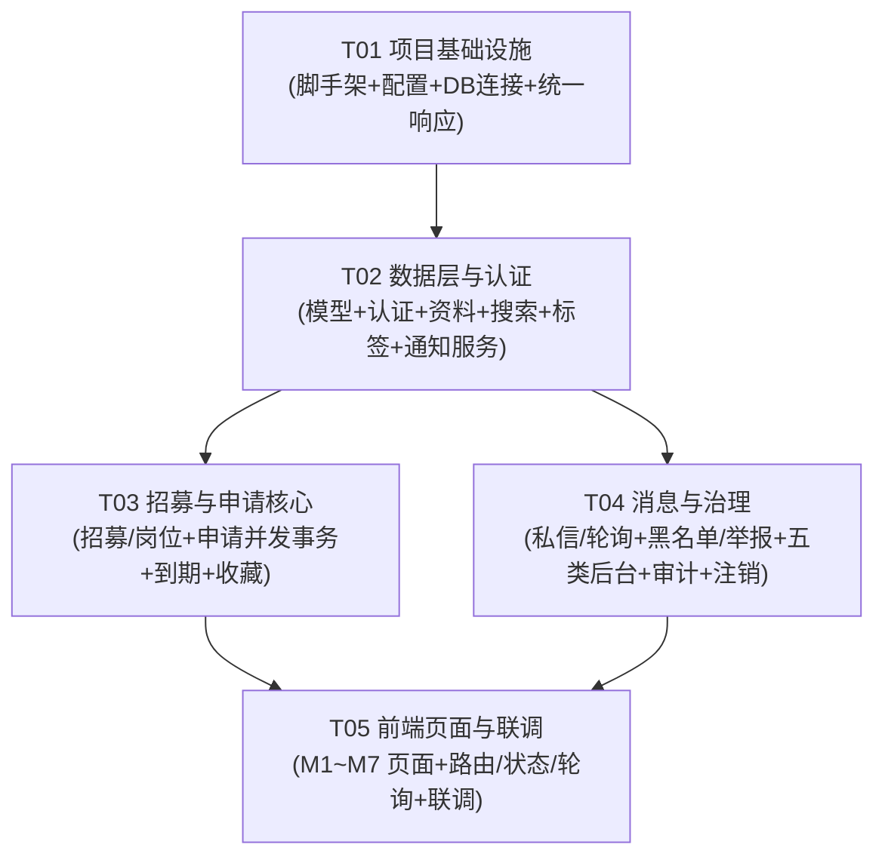

# CampusCrew 校园组队互助平台 — 系统架构设计

版本：1.0｜作者：Bob（架构师）｜基线：doc/00~03 需求文档（DEC-001~066，缺 DEC-032）

> 配套产物：
> - `database-schema.sql` — MySQL 8 建表 DDL
> - `class-diagram.mermaid` — 类图（数据模型 + 核心服务）
> - `sequence-diagram.mermaid` — 关键时序图
>
> 本文所有「已定」表示需求基线已确认；「建议/待团队确认」表示技术实现取舍，不冒充产品决策（对应 TD-01~11）。

---

# Part A：系统设计

## 1. Implementation Approach（实现方案与技术取舍）

### 1.1 核心技术难点

| # | 难点 | 说明 |
| --- | --- | --- |
| C1 | 并发一致性 | 名额不超卖（BR-04）、同招募一人一名额（BR-05）、录取后自动撤回/满员联动（BR-06）、满员立即结束（BR-07）必须在并发下原子成立（NFR-03） |
| C2 | 到期一致性 | 截止即结束，且调度延迟不能放行过期写入（NFR-04）；所有写路径以服务端统一时间为准 |
| C3 | 多维度鉴权 | 访客/未认证/已认证/封禁/管理员 + 发布者/申请者资源关系 + 管理限制（下架/封禁）叠加，后端必须强制（NFR-01） |
| C4 | 私信访问审计 | 管理员可读任意会话但必须先填原因并留痕，审计不可改删（BR-17、DEC-056~057） |
| C5 | 注销数据治理 | 注销需身份验证 + 二次确认，个人信息删除/匿名化、业务历史保留需明确方案（TD-05） |

### 1.2 框架与库选型（技术栈已定，此处细化）

**后端（FastAPI + Python 3.11+）**

| 关注点 | 选型 | 理由 |
| --- | --- | --- |
| Web 框架 | FastAPI | 已定；异步、Pydantic 校验、自动 OpenAPI |
| ORM | SQLAlchemy 2.0（同步 Session）+ PyMySQL | 课程项目可维护性优先；同步模型避免异步事务/锁踩坑，FastAPI 线程池承载；MySQL 行锁语义清晰 |
| 迁移 | Alembic | 结构变更可追踪，与 `database-schema.sql` 对齐 |
| 校验 | Pydantic v2 | FastAPI 原生；统一请求/响应 Schema |
| 认证 | JWT（PyJWT）+ bcrypt（passlib） | 无状态适合前后端分离；用 `token_version` 支持登出/封禁/改密即时撤销（详见 TD-01） |
| 邮件 | smtplib + 可配置「console」后端 | 课程环境无真实 SMTP 时，验证码落到日志/开发端点，验收可用 |
| 后台任务 | APScheduler | 到期兜底扫描；核心保证依赖「惰性到期检查」而非调度 |
| 头像存储 | 本地磁盘 + 静态目录（`/media/avatars`） | MVP 单机；大小/格式/魔数校验（NFR-07） |

**前端（React 18 + TypeScript）**

| 关注点 | 选型 | 理由 |
| --- | --- | --- |
| 构建 | Vite + React 18 + TypeScript | 已定 React；Vite 快速、TS 类型安全 |
| UI | MUI v5 + @emotion | 成熟组件库，后台表格/表单省力 |
| 路由 | react-router-dom v6 | 页面与权限守卫 |
| 请求 | axios + 统一拦截器 | 统一 `{code,message,data}` 解包与错误码处理 |
| 服务端状态 | @tanstack/react-query | 轮询、缓存、失效重取；消息轮询直接复用 |
| 客户端状态 | zustand | 轻量，存登录态/未读数 |
| 时间 | dayjs | 本地时区展示 UTC 时间 |

### 1.3 架构模式

- **后端分层**：`api(路由) → service(业务/事务) → models(ORM) → MySQL`。跨模块共享的权限判断收敛在 `core/deps.py`（PermissionGuard）；满员/到期/结束等联动只由 `ApplicationService`/`RecruitmentService` 计算，避免多模块各自算导致不一致（需求「M3/M5 状态变更及 M6 通知必须共享事件定义」）。
- **前端**：`pages(路由视图) → components(业务组件) → api(axios 封装) → hooks(react-query)`。权限按钮禁用只是辅助，后端为准。

### 1.4 状态机落地

**招募生命周期**（`status` 与「独立管理限制」分离，BR-09）：

- `status ∈ {draft, open, ended}`；`end_reason ∈ {filled, expired, manual}`（仅 ended 时填写）。
- 独立下架 = `is_taken_down=1`（管理员，可恢复）；封禁暂停 = 由 owner 的 `users.status='banned'` 派生。两者可并存、单一恢复不误清另一原因（BR-13）。
- 转移：`draft→open`（发布校验）；`open→ended/filled`（全岗满员）；`open→ended/expired`（到截止，含被隐藏）；`open→ended/manual`（手动结束）；已发布且有任意历史申请禁止删除（BR-12）；`ended` 不可重开/改结果（BR-10）。

**申请状态**：`status ∈ {pending, accepted, not_passed, withdrawn, expired}`，与 `reason` 分离保留动作差异（审计）：

| reason | 语义 |
| --- | --- |
| submitted / approved / rejected | 提交 / 通过 / 拒绝 |
| applicant_withdrawn / offer_abandoned | 主动撤回 / 主动放弃录取 |
| accepted_other_position | 同招募另一岗位通过自动撤回 |
| capacity_full | 岗位满员自动未通过 |
| blocked | 发布者拉黑自动未通过 |
| deadline_reached | 到期自动过期 |
| manual_end | 手动结束待审终态（**TD-03 建议值，非已确认**） |
| offer_revoked | 发布者撤销录取（未通过） |

**岗位状态**为派生值（不落库）：`available / full / paused / closed`，依据 recruitment status、deadline、is_taken_down、owner banned、accepted_count 计算。

### 1.5 消息中心落地

- 私信 + 系统通知统一入口；**HTTP 约 10 秒轮询**（可配置），**不使用 WebSocket**（DEC-059、BR-23）。
- 未读：私信基于 `conversation_participants.last_read_message_id` 游标；通知基于 `notifications.is_read`；全站未读 = 私信未读 + 通知未读之和（TD-09 建议）。
- 已读回执内部记录、发送者不可见（BR-16）；个人侧删除/隐藏只影响本人视图（BR-16、DEC-064）。
- 管理员私信访问先写审计、后返回正文（BR-17）。

---

## 2. File List（目录结构，backend/ 与 frontend/ 分离）

```
campus-match/
├── docs/
│   ├── system_design.md
│   ├── database-schema.sql
│   ├── class-diagram.mermaid
│   └── sequence-diagram.mermaid
├── backend/
│   ├── requirements.txt
│   ├── .env.example
│   ├── alembic.ini
│   ├── alembic/
│   │   ├── env.py
│   │   └── versions/
│   ├── app/
│   │   ├── main.py                    # FastAPI 入口、路由挂载、CORS、静态
│   │   ├── core/
│   │   │   ├── config.py              # pydantic-settings 配置
│   │   │   ├── database.py            # engine / SessionLocal / Base
│   │   │   ├── security.py            # JWT、bcrypt、验证码哈希
│   │   │   ├── exceptions.py          # 业务异常 + 错误码
│   │   │   └── deps.py                # PermissionGuard（get_current_user 等）
│   │   ├── models/
│   │   │   ├── __init__.py
│   │   │   ├── user.py                # User, EmailVerificationCode
│   │   │   ├── tag.py                 # Category, Tag, user_tags/recruitment_tags/position_tags
│   │   │   ├── recruitment.py         # Recruitment, Position
│   │   │   ├── application.py         # Application, ApplicationHistory
│   │   │   ├── message.py             # Conversation, ConversationParticipant, Message, MessageDelete
│   │   │   ├── notification.py        # Notification
│   │   │   ├── social.py              # Favorite, Blacklist
│   │   │   └── governance.py          # Report, AdminAuditLog, PrivateMessageAccessAudit
│   │   ├── schemas/                   # Pydantic 请求/响应（按模块拆分）
│   │   ├── api/v1/
│   │   │   ├── router.py
│   │   │   └── endpoints/
│   │   │       ├── auth.py
│   │   │       ├── users.py           # 资料/隐私/头像/主页/搜索/黑名单
│   │   │       ├── recruitments.py    # 招募/草稿/岗位/结束/删除
│   │   │       ├── applications.py    # 申请/审核/撤回/放弃/撤销
│   │   │       ├── favorites.py
│   │   │       ├── messages.py        # 会话/消息/轮询
│   │   │       ├── notifications.py
│   │   │       ├── reports.py
│   │   │       └── admin.py           # 五类后台 + 审计查询
│   │   ├── services/
│   │   │   ├── auth_service.py
│   │   │   ├── recruitment_service.py
│   │   │   ├── application_service.py
│   │   │   ├── message_service.py
│   │   │   ├── notification_service.py
│   │   │   ├── moderation_service.py
│   │   │   ├── deletion_service.py
│   │   │   └── search_service.py
│   │   ├── tasks/
│   │   │   ├── scheduler.py           # APScheduler 到期扫描
│   │   │   └── email.py               # 邮件发送（SMTP/console）
│   │   └── utils/
│   │       └── pagination.py          # 分页/游标封装
│   └── tests/                         # pytest（并发/权限/验收用例）
└── frontend/
    ├── package.json
    ├── vite.config.ts
    ├── tsconfig.json
    ├── index.html
    └── src/
        ├── main.tsx
        ├── App.tsx
        ├── api/                       # axios client + 各模块 API
        ├── store/                     # zustand（auth/未读）
        ├── router/                    # 路由 + 权限守卫
        ├── hooks/                     # react-query hooks
        ├── components/                # 通用组件（导航/消息入口/表格等）
        └── pages/                     # 按 M1~M7 的页面视图
```

---

## 3. Data Structures and Interfaces（数据模型与接口设计）

完整类图见 `class-diagram.mermaid`。数据模型对应 21 张 MySQL 表，完整 DDL 见 `database-schema.sql`。核心说明如下。

### 3.1 关键数据模型与并发约束（落地业务不变量）

| 不变量 | 落地方式 |
| --- | --- |
| BR-01 一邮箱一账号 | `users.email` 唯一索引（标准化后：trim + lowercase） |
| BR-04 名额不超卖 | 录取事务内 `SELECT ... FOR UPDATE` 锁 recruitment 行，原子校验 `accepted_count < capacity` 再 UPDATE |
| BR-05 同岗最多一 pending / 同招募最多一 accepted | `applications` 生成列 + 部分唯一索引：`UNIQUE(position_id, pending_guard)`、`UNIQUE(recruitment_id, accepted_guard)`（详见 DDL 注释） |
| BR-06 录取后自动撤回/满员拒绝 | 同事务内顺序执行：先撤回同人其它 pending，再拒绝该岗剩余 pending（与需求 4.2 一致） |
| BR-07 满员立即结束 | 全岗满员时同一事务 `recruitment → ended/filled` |
| BR-08 到期结束 | 惰性到期检查 + APScheduler 兜底；写路径先复检 deadline |
| BR-14 黑名单方向 | `blacklists(blocker_id, blocked_id)` 唯一；拉黑事务内拒绝其全部 pending |
| BR-16 未读/无已读回执 | `conversation_participants.last_read_message_id` 游标；发送接口不回传已读 |
| BR-17 私信访问审计 | `private_message_access_audits` 先 INSERT 再返回正文，仅 INSERT 不更新删除 |

### 3.2 核心服务接口

| 服务 | 关键方法 | 职责 |
| --- | --- | --- |
| `AuthService` | register / login / refresh / logout / send_verification_code / confirm_verification / reset_password | 账号生命周期、校园认证、会话撤销 |
| `RecruitmentService` | create_draft / publish / update_general / conditional_delete / end_manually / check_expiry | 招募生命周期、受限编辑、条件删除 |
| `ApplicationService` | submit / approve / reject / withdraw / abandon / revoke_offer | 申请审核与并发联动（核心事务） |
| `MessageService` | send / list_conversations / list_messages / mark_read / delete_for_self / hide_conversation / poll | 私信、个人侧删除/隐藏、轮询游标 |
| `NotificationService` | emit / list / unread_count / mark_read | 系统通知投递与幂等（dedup_key） |
| `ModerationService` | ban_user / unban_user / takedown / restore / resolve_report / merge_tags / access_conversation | 五类后台 + 审计 |
| `DeletionService` | delete_account / anonymize_user | 注销清理与匿名化 |
| `SearchService` | search_recruitments / search_users | 组合检索、隐私过滤 |
| `PermissionGuard` | get_current_user / require_verified / require_active / require_admin / require_*_owner | 统一鉴权，所有端点复用 |

---

## 4. Program Call Flow（关键调用流程）

完整时序图见 `sequence-diagram.mermaid`，覆盖四条关键链路：**并发录取（最后名额）**、**到期自动结束**、**管理员私信访问审计**、**私信发送与 10s 轮询**。其余 CRUD 遵循统一模式：

- **写操作**：`端点 → 鉴权(PermissionGuard) → 服务层(事务：锁招募行 → 复检 deadline/status/限制 → 业务变更 → 写历史 + 通知) → COMMIT → 统一响应`。
- **读操作**：`端点 → 鉴权 → 可见性/隐私投影过滤 → 分页/游标 → 统一响应`。

关键并发设计要点（TD-04）：以 `recruitments` 行锁作为串行化点，录取/结束/撤销/放弃/拉黑/删除/手动结束共享同一锁边界，杜绝超额与中间态；生成列唯一索引兜底防重复。

---

## 5. REST 接口约定

### 5.1 统一响应体

所有接口（含错误）返回同一结构：

```json
{ "code": 0, "message": "ok", "data": { } }
```

- `code = 0` 表示成功；非 0 为错误码。
- 分页接口 `data` 结构：`{ "items": [...], "total": 100, "page": 1, "page_size": 20 }`。
- 轮询/增量接口 `data` 结构：`{ "messages": [...], "notifications": [...], "unread_count": 5, "next_cursor": 12345 }`。

### 5.2 错误码表

| code | 含义 | 典型场景 |
| --- | --- | --- |
| 0 | 成功 | — |
| 40000 | 参数校验失败 | 字段缺失/格式错误 |
| 40100 | 未登录 | 无 token / 非法 token |
| 40101 | 登录态失效 | token 过期或 token_version 不匹配 |
| 40300 | 无权限 | 非本人资源/非管理员 |
| 40301 | 未完成校园认证 | 未验证邮箱即发布/申请/私信 |
| 40302 | 账号被封禁 | 封禁只读，禁止业务写入 |
| 40303 | 资源被下架/隐藏 | 访问受限招募 |
| 40400 | 资源不存在 | 目标 ID 不存在 |
| 40900 | 业务冲突 | 重复待审、重复占位 |
| 40901 | 岗位已满 | capacity 满 |
| 40902 | 招募已结束/已截止 | ended 或 deadline 已过 |
| 40903 | 存在历史申请不可删除 | 条件删除被拒 |
| 42900 | 频率限制 | 验证码发送过快/过多 |
| 50000 | 服务器错误 | 未预期异常 |

### 5.3 认证方式（建议）

- **JWT access token**（`exp` 30 分钟，claims：`sub`=user_id、`role`、`ver`=token_version）+ **refresh token**（14 天）。
- `token_version` 位于 `users` 表，登出/封禁/改密/注销时 `+1`，使旧 token 立即失效（单会话/单设备语义，课程 MVP 可接受）。
- 前端在 `Authorization: Bearer <access>` 携带；axios 拦截器统一处理 40101 走 refresh 或跳登录。

### 5.4 分页与排序规范

- 列表分页：`?page=1&page_size=20`（默认 20，上限 50）。
- 招募排序：`sort=latest`（`published_at DESC, id DESC`，默认）或 `sort=deadline`（`deadline_at ASC, id ASC`）。
- 轮询增量游标：`after_id`（消息用 `messages.id`，通知用 `notifications.id`）。

### 5.5 接口清单（按 M1~M7 组织）

> 前缀统一 `/api/v1`。权限列：`公开`=无需登录；`认证`=已登录；`已验证`=完成校园认证；`本人`=资源归属；`管理员`=管理权限。

**M1 账号与认证**

| 方法 | 路径 | 说明 | 权限 |
| --- | --- | --- | --- |
| POST | /auth/register | 注册（邮箱+密码+昵称） | 公开 |
| POST | /auth/login | 登录 | 公开 |
| POST | /auth/refresh | 刷新 token | 认证 |
| POST | /auth/logout | 登出（token_version+1） | 认证 |
| POST | /auth/verify-code/send | 发送验证码（register/reset_password） | 公开（频率限制） |
| POST | /auth/verify-code/confirm | 校验验证码，完成认证/重置密码 | 认证 |
| POST | /auth/password/reset | 重置密码 | 公开（凭已验证邮箱+码） |
| GET | /auth/me | 当前用户信息 | 认证 |
| POST | /account/deactivate | 自主注销（身份验证+二次确认） | 本人 |

**M2 个人资料、主页、搜索**

| 方法 | 路径 | 说明 | 权限 |
| --- | --- | --- | --- |
| GET | /users/me | 我的完整资料 | 本人 |
| PUT | /users/me/profile | 更新资料（昵称必填，其余选填） | 本人 |
| PUT | /users/me/privacy | 更新隐私/搜索开关 | 本人 |
| PUT | /users/me/avatar | 上传头像 | 本人 |
| GET | /users/{id} | 他人主页（按隐私投影） | 认证（访客仅昵称头像） |
| GET | /users/search | 用户搜索（昵称/技能兴趣标签） | 认证 |
| GET | /users/{id}/recruitments | 公开发布 | 按隐私 |
| GET | /users/{id}/applications | 公开申请（不含状态/留言/结果） | 按隐私 |
| GET | /users/{id}/teams | 公开队伍（不含其他成员） | 按隐私 |

**M3 招募、草稿、岗位**

| 方法 | 路径 | 说明 | 权限 |
| --- | --- | --- | --- |
| POST | /recruitments | 创建草稿（status=draft/open） | 已验证 |
| GET | /recruitments/drafts | 我的草稿 | 本人 |
| GET | /recruitments/mine | 我的发布 | 本人 |
| GET | /recruitments/{id} | 详情（含逐岗容量/状态/允许操作） | 公开（受治理限制） |
| PUT | /recruitments/{id} | 一般内容编辑（标题/描述/地点/标签，冻结名额/截止/岗位） | 本人 |
| POST | /recruitments/{id}/publish | 发布草稿（完整校验） | 本人 |
| POST | /recruitments/{id}/end | 手动结束 | 本人 |
| DELETE | /recruitments/{id} | 条件删除（无历史申请） | 本人 |
| POST | /recruitments/{id}/positions | 新增岗位（仅草稿） | 本人 |
| DELETE | /recruitments/{id}/positions/{pid} | 删除岗位（仅草稿） | 本人 |

**M4 发现、详情、收藏**

| 方法 | 路径 | 说明 | 权限 |
| --- | --- | --- | --- |
| GET | /recruitments | 公开列表（关键词/分类/标签/可申请/截止范围/地点组合筛选 + 排序分页） | 公开 |
| POST | /recruitments/{id}/favorite | 收藏（幂等） | 已验证 |
| DELETE | /recruitments/{id}/favorite | 取消收藏 | 本人 |
| GET | /users/me/favorites | 我的收藏 | 本人 |

**M5 申请与审核**

| 方法 | 路径 | 说明 | 权限 |
| --- | --- | --- | --- |
| POST | /recruitments/{id}/positions/{pid}/applications | 提交申请（可选留言） | 已验证 |
| GET | /applications/mine | 我的申请 | 本人 |
| GET | /users/me/teams | 我的队伍（历史视图） | 本人 |
| GET | /recruitments/{id}/applications | 发布者查看申请列表 | 本人（发布者） |
| POST | /applications/{id}/approve | 通过（并发联动） | 本人（发布者） |
| POST | /applications/{id}/reject | 拒绝 | 本人（发布者） |
| POST | /applications/{id}/withdraw | 撤回 | 本人（申请者） |
| POST | /applications/{id}/abandon | 放弃录取 | 本人（申请者） |
| POST | /applications/{id}/revoke | 撤销录取 | 本人（发布者） |

**M6 消息中心**

| 方法 | 路径 | 说明 | 权限 |
| --- | --- | --- | --- |
| POST | /conversations | 创建/获取会话（发私信入口） | 已验证 |
| POST | /conversations/{id}/messages | 发送私信 | 会话成员 |
| GET | /conversations | 会话列表（含未读） | 本人 |
| GET | /conversations/{id}/messages | 消息列表（游标分页） | 会话成员 |
| POST | /conversations/{id}/read | 标记已读 | 会话成员 |
| POST | /messages/{id}/delete | 个人侧删除消息 | 本人 |
| POST | /conversations/{id}/hide | 隐藏会话 | 本人 |
| GET | /notifications | 系统通知列表 | 本人 |
| POST | /notifications/read | 批量已读 | 本人 |
| GET | /poll | 轮询增量（新消息+通知+未读） | 本人 |

**M7 治理与五类管理后台**

| 方法 | 路径 | 说明 | 权限 |
| --- | --- | --- | --- |
| POST | /blacklists | 拉黑（自动拒绝其全部待审） | 已验证 |
| DELETE | /blacklists/{id} | 解黑 | 本人 |
| GET | /users/me/blacklist | 黑名单列表 | 本人 |
| POST | /reports | 举报（recruitment/user/message） | 已验证 |
| GET | /admin/users | 用户列表 | 管理员 |
| POST | /admin/users/{id}/ban | 封禁（原因必填） | 管理员 |
| POST | /admin/users/{id}/unban | 解封 | 管理员 |
| GET | /admin/recruitments | 招募列表 | 管理员 |
| POST | /admin/recruitments/{id}/takedown | 下架（原因必填） | 管理员 |
| POST | /admin/recruitments/{id}/restore | 恢复 | 管理员 |
| GET | /admin/reports | 举报列表 | 管理员 |
| POST | /admin/reports/{id}/resolve | 处置（dismiss/resolve + 处罚动作） | 管理员 |
| GET/POST/PUT/DELETE | /admin/categories | 分类维护 | 管理员 |
| GET/POST/PUT | /admin/tags | 标签维护 | 管理员 |
| POST | /admin/tags/merge | 合并标签 | 管理员 |
| GET | /admin/conversations | 会话列表 | 管理员 |
| POST | /admin/conversations/{id}/access | 填原因发起访问（写审计） | 管理员 |
| GET | /admin/conversations/{id}/messages | 读会话消息（复用 request_id） | 管理员 |
| GET | /admin/audit/private-messages | 私信访问审计查询（只读） | 管理员 |

---

## 6. Anything UNCLEAR（未明确项与假设）

所有未定项已归入 TD-01~11 并给出「建议」取值，**不冒充已确认决策**。核心假设：

1. **单校域名**：MVP 仅一个校园邮箱域名，通过配置 `ALLOWED_EMAIL_DOMAINS` 白名单注入（建议值 `@stu.example.edu`，部署时替换）。
2. **单会话/单设备撤销语义**：采用 `token_version` 撤销，登出会失效该账号全部登录（课程 MVP 可接受；多设备需改为 sessions 表）。
3. **验证码走 MySQL 落库**（非 Redis），哈希存储 + 频率限制 + 尝试上限。
4. **字段长度/分类字典/分页默认值**：见 DDL 与 TD-02，均为建议值，实现可等价调整但不破坏 BR 不变量。
5. **通知「投递」即落库**：站内通知在业务事务内写入 `notifications`，提交即对接收者可见，无需额外队列；`dedup_key` 保证重试不重复。

---

## 7. TD-01~11 技术取舍表（逐项标注「已定 / 建议」）

| 编号 | 事项 | 结论与实现建议 | 级别 |
| --- | --- | --- | --- |
| TD-01 | 校园域名/验证码/会话/找回 | 域名白名单配置化（单校一个域名）；邮箱 trim+lowercase 后唯一；6 位数字验证码、10 分钟有效、60s 冷却、每邮箱每小时 ≤5 次、最多 5 次尝试、SHA-256 哈希存储、用后作废；会话 JWT access(30min)+refresh(14d)+`token_version` 撤销（登出/封禁/改密/注销 +1）；找回密码走已验证邮箱重置码 | 已定：邮箱+密码、一邮箱一账号；**建议：域名/时长/频率/会话撤销细节** |
| TD-02 | 字段/时间/分页/字典 | 字段长度见 DDL；时间统一 UTC `DATETIME(3)`、服务端 `now` 判断截止；分页 `page/page_size`（默认 20 上限 50）；排序 `published_at DESC,id DESC` / `deadline_at ASC,id ASC`；分类 seed（课程项目/学科竞赛/科研社团/文体娱乐/生活互助）；头像 jpg/png/webp ≤2MB + 魔数校验 | **建议**（已定：服务端一致时间 NFR-04） |
| TD-03 | 手动结束待审终态 | 待审 `pending → expired`，`reason=manual_end`，通知沿用 `application_expired` 变体 | **建议**（明确：不冒充 DEC-016 已确认，AT-14 须标注） |
| TD-04 | 事务/锁/调度/幂等 | 行锁串行化 + 生成列唯一索引；惰性到期检查优先、APScheduler 30s 兜底；通知同事务落库 + dedup_key 幂等 | 已定：容量/结束锁定必须成立；**建议：锁与调度实现** |
| TD-05 | 注销清理 | 二次确认后：个人信息匿名化（email→`deleted_{id}@invalid.local`、密码清空、昵称→「已注销用户」、其余资料置空、is_verified=0）；会话撤销；草稿物理删除；未结束招募自动 `ended/manual`（待审 `expired/manual_end`）；本人 pending→`withdrawn`（建议值 `applicant_deleted`）、accepted 历史保留匿名化；消息/审计保留不物理删；**原邮箱不可再注册**（unique 占位）；封禁者允许注销 | **建议**（BR-22 已定：必须验证+二次确认、原账号不可用） |
| TD-06 | 主页投影/队伍口径 | 访客仅返回 `nickname+avatar_url`；认证用户按三开关投影（公开申请只给招募+岗位；公开队伍只给通过招募+岗位，不含其他成员）；「我的队伍」= 当前 `accepted` 记录，曾通过后撤销/放弃者不再展示 | **建议** |
| TD-07 | 暂停期间/封禁者边界 | 下架/封禁暂停期间禁止一切结果写入（含撤回/放弃/内容修改），待审保留、到期照常过期；申请者封禁时其存量 pending 仍可被发布者审核（不擅自取消）；接收方封禁/注销时发送方可继续发送（消息留痕，接收方只读）；封禁者读取自动更新本人已读标记作为系统内部维护例外（非业务写入） | **建议** |
| TD-08 | 管理员授权/审计 | `users.is_admin`（或 role）标记，种子/数据库授予，无注册成管理员通道；管理员被封禁时管理权限失效（登录只读）；同一次私信分页访问复用同一 `request_id`（仅一次审计）；审计表仅 INSERT（应用层禁止 UPDATE/DELETE），可加 DB 只读权限加固 | 已定：五类后台、先审计后正文、普通后台不可改删审计；**建议：授予方式/复用策略/防篡改** |
| TD-09 | 轮询/隐藏/未读 | 间隔 10s 可配置；游标 `after_id`（messages.id/notifications.id）；隐藏会话收到新消息自动取消隐藏；删除仅个人侧不影响对方未读；未读基于 `last_read_message_id` 计算 | **建议** |
| TD-10 | 重复举报/标签合并/收藏占位 | 同一用户对同一目标仅一条 pending 举报（唯一约束建议）；已结案后可再次举报；目标被删/注销后举报保留快照并可标 `target_invalid`；标签合并=迁移引用到目标、源标签 `is_active=0`（事务）；收藏指向已删除/受限招募时返回安全占位「内容不可用」 | **建议** |
| TD-11 | 自申请/重复占位 | 拒绝「申请自己发布的招募」（明确反馈）；已有 accepted 者再申请同招募其它岗位拒绝（BR-05）；再次申请仅限被拒绝/主动撤回者（DEC-007 明确），过期/满员/自动撤回按岗位是否 available 判定 | **建议** |

---

# Part B：任务分解

## 8. Required Packages（依赖包列表）

```
后端（backend/requirements.txt）：
- fastapi@^0.115.0           : Web 框架
- uvicorn[standard]@^0.30.0   : ASGI 服务器
- sqlalchemy@^2.0.30          : ORM
- pymysql@^1.1.0              : MySQL 驱动
- alembic@^1.13.0             : 数据库迁移
- pydantic@^2.8.0             : 数据校验
- pydantic-settings@^2.4.0    : 配置加载
- email-validator@^2.2.0      : 邮箱格式校验
- PyJWT@^2.9.0                : JWT
- passlib[bcrypt]@^1.7.4      : 密码哈希
- bcrypt@^4.1.0               : passlib 依赖
- python-multipart@^0.0.9     : 头像上传
- apscheduler@^3.10.0         : 到期兜底调度
- python-dotenv@^1.0.0        : 环境变量
（开发）：pytest、httpx

前端（frontend/package.json）：
- react@^18.3.0 / react-dom@^18.3.0
- react-router-dom@^6.26.0    : 路由
- axios@^1.7.0                : HTTP 客户端
- @mui/material@^5.16.0       : UI 组件库
- @emotion/react / @emotion/styled
- @mui/icons-material@^5.16.0
- zustand@^4.5.0              : 客户端状态
- @tanstack/react-query@^5.51.0 : 服务端状态/轮询
- dayjs@^1.11.0               : 时间格式化
- vite@^5.4.0 / @vitejs/plugin-react@^4.3.0 / typescript@^5.5.0
```

## 9. Task List（按依赖排序，共 5 个任务）

| 任务 | 名称 | 依赖 | 优先级 |
| --- | --- | --- | --- |
| T01 | 项目基础设施（前后端脚手架 + 数据库连接 + 统一响应/错误码） | — | P0 |
| T02 | 数据层与认证（全部模型 + 认证/资料/隐私/搜索/标签 + 通知服务） | T01 | P0 |
| T03 | 招募与申请核心（招募/岗位/草稿 + 申请审核并发事务 + 到期调度 + 收藏） | T02 | P0 |
| T04 | 消息与治理（私信/轮询/通知 + 黑名单/举报 + 五类后台 + 审计 + 注销） | T02 | P0 |
| T05 | 前端页面与联调（M1~M7 页面 + 路由/状态/轮询 + 端到端联调） | T03, T04 | P0 |

### T01 项目基础设施
- **Source Files**：`backend/requirements.txt`、`backend/.env.example`、`backend/alembic.ini`、`backend/alembic/env.py`、`backend/app/main.py`、`backend/app/core/config.py`、`backend/app/core/database.py`、`backend/app/core/exceptions.py`、`backend/app/api/v1/router.py`、`backend/app/utils/pagination.py`；`frontend/package.json`、`frontend/vite.config.ts`、`frontend/tsconfig.json`、`frontend/index.html`、`frontend/src/main.tsx`、`frontend/src/App.tsx`、`frontend/src/api/client.ts`、`frontend/src/router/index.tsx`
- **内容**：FastAPI 应用骨架 + CORS + 静态目录；配置中心；DB engine/Session/Base；统一 `{code,message,data}` 响应体与异常处理器 + 错误码表；分页工具；Alembic 初始化；前端 Vite 脚手架 + axios 拦截器（统一解包/401 处理）+ 路由骨架。

### T02 数据层与认证
- **Source Files**：`backend/app/models/*`（8 个模型文件）、`backend/app/schemas/*`、`backend/app/core/security.py`、`backend/app/core/deps.py`、`backend/app/api/v1/endpoints/auth.py`、`backend/app/api/v1/endpoints/users.py`、`backend/app/services/auth_service.py`、`backend/app/services/search_service.py`、`backend/app/services/notification_service.py`、`backend/app/tasks/email.py`、`backend/alembic/versions/*`、`docs/database-schema.sql`
- **内容**：21 张表模型 + 迁移（含生成列唯一索引）；JWT/bcrypt/验证码哈希；PermissionGuard（访客/未认证/封禁/管理员/资源关系）；注册/登录/刷新/登出/校园认证/找回；资料/隐私/头像/主页投影/用户搜索；分类与标签（含用户自建标签）；统一通知服务（emit/list/unread，供 T03/T04 复用）。

### T03 招募与申请核心
- **Source Files**：`backend/app/api/v1/endpoints/recruitments.py`、`backend/app/api/v1/endpoints/applications.py`、`backend/app/api/v1/endpoints/favorites.py`、`backend/app/services/recruitment_service.py`、`backend/app/services/application_service.py`、`backend/app/tasks/scheduler.py`、`backend/tests/*`（并发/到期/权限用例）
- **内容**：草稿/发布/受限编辑/条件删除/手动结束/到期（惰性+调度）；岗位增删（仅草稿）与名额；申请提交/通过/拒绝/撤回/放弃/撤销录取的并发事务（行锁 + 满员/结束联动 + 历史 + 通知）；收藏与我的收藏。

### T04 消息与治理
- **Source Files**：`backend/app/api/v1/endpoints/messages.py`、`backend/app/api/v1/endpoints/notifications.py`、`backend/app/api/v1/endpoints/reports.py`、`backend/app/api/v1/endpoints/admin.py`、`backend/app/services/message_service.py`、`backend/app/services/moderation_service.py`、`backend/app/services/deletion_service.py`、`backend/tests/*`
- **内容**：私信会话/消息/已读/个人侧删除/隐藏/轮询；通知读/未读；黑名单（含待审联动）；举报提交；五类管理后台（用户封禁解封、招募下架恢复、举报处置、分类标签维护/合并、私信访问审计）；自主注销与匿名化。

### T05 前端页面与联调
- **Source Files**：`frontend/src/api/*`（各模块 API）、`frontend/src/store/*`、`frontend/src/hooks/*`、`frontend/src/components/*`、`frontend/src/pages/*`（M1~M7 全部页面）、`frontend/src/router/*`
- **内容**：登录注册/校园认证/个人中心（资料/隐私/我的发布/申请/队伍/收藏/黑名单/注销）；发现列表（组合筛选排序）；招募详情与发布（草稿/岗位）；申请管理与审核；消息中心（会话/通知/10s 轮询/全站未读）；管理后台五类页面；端到端联调与权限负向验证（NFR-01）。

---

## 10. Shared Knowledge（跨文件约定）

```
- 所有接口统一返回 {code, message, data}；code=0 成功，错误码见 5.2。
- 认证：JWT Bearer（access 30min / refresh 14d），token_version 撤销；登出/封禁/改密/注销使旧 token 失效。
- 时间：数据库统一 UTC DATETIME(3)；截止判断一律用服务端 now，前端仅做本地时区展示。
- 时间精度：毫秒；排序稳定追加 id 决胜。
- 权限：一切写权限后端强制校验；前端按钮禁用仅为辅助，不作为安全边界。
- 招募 status ∈ {draft,open,ended}，end_reason ∈ {filled,expired,manual}；下架/封禁为独立限制原因集合，不覆盖生命周期。
- 申请 status ∈ {pending,accepted,not_passed,withdrawn,expired}，reason 与 status 分离，保留动作差异。
- 通知：业务事务内同库落表，dedup_key = SHA256(event_id + recipient_id) 幂等；失败重试不重复。
- 私信：服务器保留正文；个人侧删除/隐藏仅改本人视图；发送者不可见对方已读。
- 管理员私信访问：先写 private_message_access_audits（原因必填、request_id 幂等），审计成功后才返回正文；审计表仅 INSERT。
- 软删除：用户/招募业务删除用 status/deleted_at/is_active，不物理删除，保证历史与治理可追溯。
- 邮箱：标准化 trim + lowercase 后唯一；校园域名白名单配置化。
- 密码/验证码：bcrypt 密码、SHA-256 验证码哈希，日志与响应不回显明文（NFR-02）。
```

---

## 11. Task Dependency Graph（任务依赖图）



**依赖说明**：T01 为唯一起点（基础设施）；T02 提供全部模型与共享的鉴权/通知服务；T03 与 T04 仅依赖 T02，可并行开发（T03 招募申请、T04 消息治理）；T05 汇总集成 T03 与 T04 的后端能力完成前端与联调。
