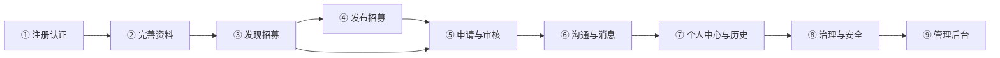
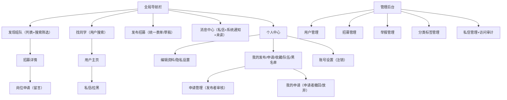
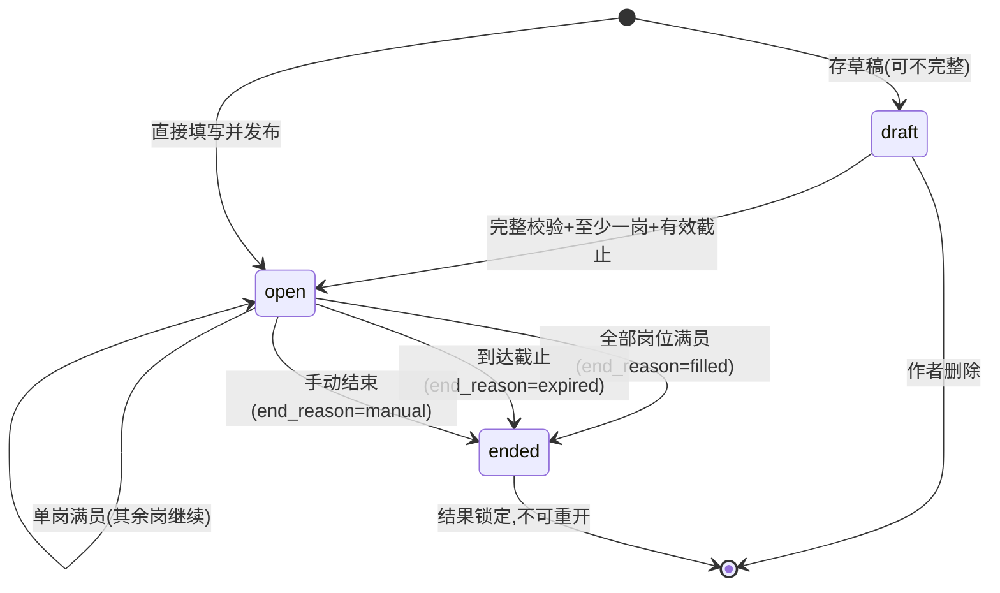
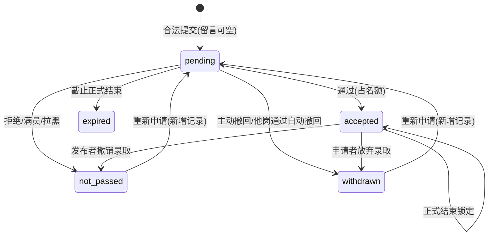
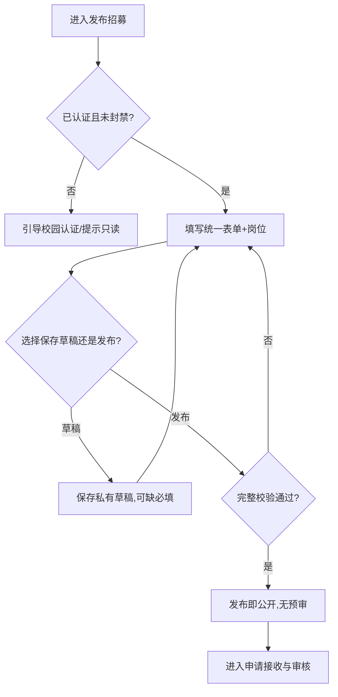
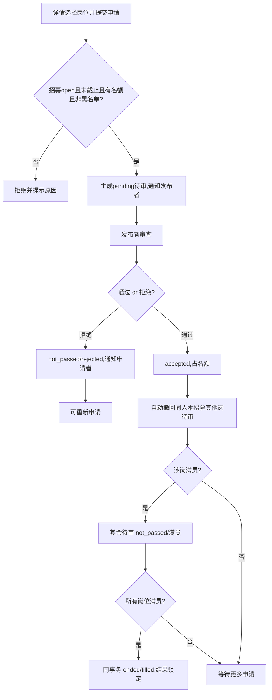

# CampusCrew 校园组队互助平台 —— 需求规格说明书与交互原型

| 项目 | 内容 |
| --- | --- |
| 项目名称 | CampusCrew 校园组队互助平台（课程题目对外名称：招聘网站） |
| 文档类型 | 软件工程课程大作业 · 第一部分（需求规格说明书 + 交互原型设计） |
| 版本 | 1.0 |
| 基线日期 | 2026-10-13 |
| 作者 | 产品经理 · 许清楚（Alice） |
| 技术栈 | React（前端） + FastAPI（后端） + MySQL（数据库） |
| 需求依据 | `doc/00-decisions.md`（DEC-001~066）、`doc/01-product.md`、`doc/02-requirements.md`、`doc/03-business-rules.md` |

---

## 1. 简介

### 1.1 目的

本文档完成课程大作业**第一部分**的全部五项内容，用于向评审说明「为什么做、为谁做、怎么做对」：

1. 项目的背景和目标；
2. 典型用户分析、用户痛点问题；
3. 需求调研的方法、过程及调研结果；
4. 用户故事地图与用户故事卡，并评估优先级与技术实现难度；
5. 针对关键用户故事的产品原型（页面线框与交互流程）。

本文是后续「第二部分：总体架构与技术选型」「第三部分：开发迭代计划」的需求输入，不包含总体架构设计与迭代排期内容。

### 1.2 范围

CampusCrew 是**服务一所学校**的校园组队互助与任务型招募匹配平台。它帮助学生把「需要谁来一起完成什么事」表达成可搜索、带岗位名额和截止时间的招募，通过申请、审核及私信完成匹配。

**范围边界（明确不做什么）：**

- 不扩展到跨校平台、企业招聘、支付及资金托管；
- 不建立长期 Team/TeamMember 队伍实体，不管理组队后的实际协作与外部交流群；
- 不做七天确认期、候补、已结束招募自动重开；
- 不做正式邀请/直接加入、招募图片附件、草稿自动保存；
- 不做智能推荐、热门榜、订阅提醒、置顶加急、独立统计看板；
- 不做 WebSocket（消息用 HTTP ~10s 轮询）、发送者可见的已读回执。

### 1.3 定义、缩写与术语

| 术语 | 定义 |
| --- | --- |
| 招募（Recruitment） | 围绕一次任务的公开需求；初稿中的 Post/需求统一称「招募」 |
| 岗位（Position） | 招募内独立名称、名额和要求；名额表示可录取申请者数量 |
| 申请（Application） | 用户对一个岗位的一次提交；重新申请产生新的历史记录 |
| 录取 / 通过 | 申请当前状态为 accepted，占该岗位一个名额 |
| 我的队伍 | 由「通过申请」形成的历史组队视图，不是长期队伍实体 |
| 正式结束 | `status=ended`，`end_reason=filled/expired/manual`，结果锁定 |
| 下架 | 管理员对内容的独立管理限制，不等于正式结束，也不延长截止时间 |
| 封禁暂停 | 因发布者封禁导致的隐藏与交互暂停，区别于独立违规下架 |
| 用户级黑名单 | 有方向的用户关系，阻止被拉黑者向拉黑者申请及发送私信 |
| 系统角色 | 仅「普通用户」「管理员」两类；发布者/申请者是业务关系 |
| P0 | 本次必须实现并验收的能力；P1/P2 为范围外候选 |
| TD | 待技术设计确认项（TD-01~11），不得冒充已确认决策 |

### 1.4 参考文献

1. `doc/00-decisions.md` —— CampusCrew MVP 产品决策记录（DEC-001~066）
2. `doc/01-product.md` —— 产品定义与 MVP 范围
3. `doc/02-requirements.md` —— 功能需求与验收规格（F-01~39、NFR、验收场景）
4. `doc/03-business-rules.md` —— 业务规则、状态机与权限（BR-01~24）
5. 《校园组队平台-需求分析文档》初稿（仅作背景参考，与决策冲突处以四份基线为准）

### 1.5 文档组织

第 2~6 章分别对应作业五项；第 7 章补充非功能需求约束（对应 SRS 模板「详细需求」中的性能与质量属性）；第 8 章为待技术设计确认清单，作为与第二部分架构设计的交接。

---

## 2. 项目背景与目标（作业(1)）

### 2.1 项目背景与产品定位

大学校园里存在大量「任务型组队」需求：课程项目要凑齐编程、文案、汇报的不同能力；学科竞赛要按岗位招人；社团科研任务、体育活动与生活互助要找搭子。这些需求长期依赖群消息、熟人圈和口头传播，存在**信息沉底、找不对人、进度不清、结果不透明、缺乏治理**等问题。

CampusCrew 的产品定位是：**面向一所学校的校园组队互助与任务型招募匹配平台**。它不追求「招聘」的企业 HR 语义，而把组队这件事结构化——用「招募（含多岗位、独立名额、截止时间）」承载需求，用「申请—审核—私信」完成匹配闭环。

> 对外统一口径为「校园组队互助平台」，不称「企业招聘」。

### 2.2 价值主张

| 当前痛点 | 产品响应 | 价值边界 |
| --- | --- | --- |
| 群消息容易沉底、难以持续发现 | 公开列表、关键词和多条件检索、收藏 | 不做推荐算法或付费曝光 |
| 熟人圈难以找到合适技能的人 | 校园认证用户搜索、技能兴趣标签 | 搜索可见性可关闭，不保证匹配成功 |
| 招募人数、岗位与进度不清楚 | 多岗位独立名额、申请状态、明确结束原因 | 不建立长期团队管理 |
| 重复联系和申请结果不透明 | 独立申请记录、系统通知、私信 | 无对方已读回执，不保证实时送达 |
| 骚扰、违规内容缺乏处理路径 | 用户级黑名单、举报、管理员人工核实与审计 | 举报不自动处罚，不建立信誉评分 |

### 2.3 项目目标

1. **打通业务闭环**：合法用户可完整完成「注册认证 → 发布 → 发现检索 → 申请 → 审核 → 通知」，且权限、隐私不能通过直接调用接口绕过。
2. **保证状态与容量一致**：在并发录取、满员、截止等边界下，名额不超发、结果不出现中间状态、结束后锁定。
3. **可追溯治理**：举报人工处置、下架/封禁/私信访问均有据可查，管理员敏感操作留痕。

### 2.4 成功定义与验收口径

成功首先是**可重复验证的业务闭环**。课程评审以功能验收场景（AT-01~14）与业务不变量（BR-01~24）为依据，提供页面演示、状态转移用例、并发测试及管理审计证据；**无需独立统计看板即可验收**。

> 说明：不虚构 KPI、用户规模、响应时间或法律合规保证；满员不等于实际合作成功。

---

## 3. 典型用户分析与痛点（作业(2)）

### 3.1 干系人与系统角色

系统角色仅两类：**普通用户**、**管理员**。发布者/申请者是业务关系而非系统角色，同一用户可同时是多个招募的发布者和多个招募的申请者。

| 类型 | 名称 | 含义 |
| --- | --- | --- |
| 访问身份 | 访客 | 未登录访问者，可浏览搜索公开招募；仅见发布者昵称头像 |
| 系统角色 | 普通用户 | 使用资料、招募、申请、消息等；写入权限受认证与封禁限制 |
| 系统角色 | 管理员 | 在五类后台内管理用户、招募、举报、分类标签、私信；敏感操作留痕 |
| 账号状态 | 未认证 / 已认证 | 是否完成校园邮箱验证码验证 |
| 账号状态 | 正常 / 封禁 / 已注销 | 封禁账号可登录只读；已注销不可继续使用 |
| 业务关系 | 发布者 | 当前招募所有者，管理该招募及其申请 |
| 业务关系 | 申请者 | 当前申请提交者，查看、撤回申请或在允许时放弃录取 |

### 3.2 典型用户与行为分析

| 用户 | 职责与特征 | 行为分析 | 痛点 |
| --- | --- | --- | --- |
| 访客 | 未登录、未认证，仅浏览 | 进入公开列表 → 搜索/筛选 → 查看详情与发布者昵称头像；完整主页/交互被拒绝 | 只能看、无法联系；信息有限，被迫先注册 |
| 普通用户（发布者视角） | 已认证学生，发布并管理招募 | 完善昵称 → 存草稿或填写完整表单 → 发布即公开 → 接收申请 → 逐岗审核 → 满员/到期结束 | 群消息沉底难被发现；岗位名额与进度不清；重复联系；遇骚扰缺乏处理手段 |
| 普通用户（申请者视角） | 已认证学生，申请他人招募 | 找到可申请招募 → 选岗位、可留言 → 提交待审 → 查看结果通知；可申请同招募多岗位 | 熟人圈难找对技能的人；申请结果不透明；担心隐私被过度暴露 |
| 管理员 | 平台治理人员 | 在五类后台管理用户、招募、举报、分类标签、私信；敏感操作留痕 | 违规内容处置缺乏人工核实与审计路径；私信治理与隐私边界需权衡 |

### 3.3 典型业务场景

| 场景 | 发起者需求 | 参与者路径 |
| --- | --- | --- |
| 课程项目 | 为某项课程任务寻找不同能力的伙伴 | 搜索课程关键词，选择岗位，申请并等待审核 |
| 学科竞赛 | 招募编程、写作等岗位，各岗独立名额 | 展示自愿公开资料，与发布者沟通后申请 |
| 科研或社团任务 | 围绕明确任务寻找参与者 | 按分类、技能标签、地点与截止时间筛选 |
| 体育、娱乐与生活互助 | 为一次活动或短期互助寻找搭子 | 浏览公开招募，认证后申请或私信 |

---

## 4. 需求调研方法与过程及结果（作业(3)）

### 4.1 调研方法

| 方法 | 目标 | 产出 |
| --- | --- | --- |
| 文献调研 | 明确课程作业边界与同类系统常见模块 | 课程题目背景、SRS 模板结构 |
| 竞品分析 | 归纳组队/招募类产品的能力与不足 | 对标功能清单与「不做」清单 |
| 问卷调查 | 收集学生组队痛点与功能期待（定性为主） | 痛点频次与优先级排序 |
| 用户访谈 | 深入典型用户（发布者/申请者）的完整旅程 | 核心用户旅程与边界诉求 |
| 场景建模 | 用角色+场景验证功能完整性 | 四类典型场景（§3.3） |

> 依据基线约定，本报告**只陈述定性结论**，不虚构问卷样本量、转化率等量化 KPI。

### 4.2 调研过程

1. **需求收集**：通读课程题目与《校园组队平台-需求分析文档》初稿，梳理初稿中的角色、模块与用户故事示例。
2. **需求分析**：针对初稿中「先审核再公开」「长期队伍管理」「七天确认期」「候补」「每人只能申请一次」「管理员仅看举报私信」等模糊/过度设计，逐一比对真实场景，提炼取舍问题。
3. **需求决策**：以问答与补充说明的形式对冲突点逐条定案，形成 DEC-001~066 产品决策记录；较晚决策覆盖较早决策（如 DEC-048 取消七天确认期、DEC-056 最终修订版开放管理员全量私信审计）。
4. **需求固化**：将决策落为产品定义（01）、功能需求（02）、业务规则（03）三份基线，并在冲突时以最终决策为准。

### 4.3 调研结果

调研结论可归纳为「一个定位、五类痛点、七模块、两类角色」：

1. **定位收敛**：本质是「校园组队互助」，非企业招聘；仅服务一所学校，用「招募+岗位+申请」结构化组队。
2. **痛点确认**：沉淀为 §2.2 价值主张表五条痛点（信息沉底、找不对人、名额进度不清、结果不透明、缺乏治理）。
3. **范围收敛（关键取舍）**：发布后先公开再由管理员事后处置（DEC-003）；不建长期队伍实体（DEC-013）；满员立即结束、无确认期无候补（DEC-047/048）；多岗位独立名额、一人一岗一位（DEC-004~007）；系统角色仅普通用户/管理员。
4. **模块划分**：形成 M1 账号认证、M2 个人资料、M3 招募、M4 发现、M5 申请审核、M6 消息、M7 治理与管理后台共七模块（对应功能 F-01~39）。
5. **技术约束**：React + FastAPI + MySQL；消息用 HTTP ~10s 轮询不用 WebSocket。

---

## 5. 用户故事地图与用户故事卡（作业(4)）

### 5.1 用户故事地图

**主干（用户活动，从左到右按业务流程排列）**：

**用户活动 → 用户任务 → 用户故事（纵向按重要程度从高到低）**：

| 用户活动 | 用户任务 | 用户故事 | 优先级 | 技术难度 |
| --- | --- | --- | --- | --- |
| ① 注册认证 | 建立账号 | US-01 注册、US-02 登录退出 | 高 | 低 |
| ① 注册认证 | 校园身份认证 | US-03 邮箱验证码认证 | 高 | 中 |
| ① 注册认证 | 权限守卫 | US-04 统一授权守卫 | 高 | 中 |
| ② 完善资料 | 编辑资料 | US-05 个人资料与标签 | 中 | 中 |
| ② 完善资料 | 隐私设置 | US-06 主页隐私与搜索设置 | 中 | 中 |
| ② 完善资料 | 主页与找同学 | US-07 个人主页、US-08 用户搜索 | 中 | 中 |
| ③ 发现招募 | 检索浏览 | US-15 列表与组合搜索、US-16 排序 | 高 | 中/低 |
| ③ 发现招募 | 查看与收藏 | US-17 详情与历史、US-18 收藏 | 高/中 | 低 |
| ④ 发布招募 | 起草与发布 | US-09 草稿、US-10 发布、US-11 多岗位名额 | 高 | 中 |
| ④ 发布招募 | 维护与结束 | US-12 一般编辑、US-13 条件删除、US-14 手动/自动结束 | 中 | 低~高 |
| ⑤ 申请与审核 | 提交申请 | US-19 提交与重新申请 | 高 | 中 |
| ⑤ 申请与审核 | 跟踪结果 | US-20 我的申请/我的队伍 | 高 | 中 |
| ⑤ 申请与审核 | 审核录取 | US-21 审查、US-22 通过与联动、US-23 拒绝 | 高 | 高/低 |
| ⑤ 申请与审核 | 结果调整 | US-24 撤回/放弃、US-25 撤销录取、US-26 自动终态 | 中~高 | 中~高 |
| ⑥ 沟通与消息 | 私信 | US-27 自由私信、US-31 个人侧删除/隐藏 | 高/低 | 中/低 |
| ⑥ 沟通与消息 | 通知与未读 | US-28 未读、US-29 轮询、US-30 系统通知 | 高 | 中 |
| ⑦ 个人中心与历史 | 历史与账号 | US-20 我的队伍视图、US-38 自主注销 | 中/低 | 中/高 |
| ⑧ 治理与安全 | 用户自助治理 | US-32 黑名单、US-33 举报提交 | 中 | 中 |
| ⑨ 管理后台 | 五类管理 | US-34 下架恢复、US-35 封禁解封、US-36 分类标签、US-37 私信审计、US-39 举报处置 | 低 | 中~高 |

### 5.2 用户故事卡

**故事卡格式**：`作为[角色]，他/她可以[功能]，以便[价值]`；每条标注「优先级：高/中/低；技术实现难度：高/中/低」。

> 说明：下列 39 条故事全部落在 MVP（P0）范围内；此处的「优先级」为**相对优先级**，用于指导开发顺序（先打通核心闭环、再补治理与后台），不代表可从 MVP 裁剪。

| 故事 | 用户故事（作为…可以…以便…） | 对应功能 | 优先级 | 技术难度 | 关键难点/依据 |
| --- | --- | --- | --- | --- | --- |
| US-01 | 作为本校学生，我可以**用校园邮箱+密码注册**，以便建立唯一账号 | F-01 | 高 | 低 | 邮箱唯一、并发注册唯一；DEC-062 |
| US-02 | 作为用户，我可以**登录/退出**，以便进入会话与受控状态 | F-02 | 高 | 低 | 封禁只读、注销失效；DEC-055 |
| US-03 | 作为学生，我可以**邮箱验证码认证**，以便获得发布/申请/私信资格 | F-03 | 高 | 中 | 邮件服务、验证码时效；DEC-002 |
| US-04 | 作为用户，我可以**获得页面与接口一致的授权**，以便不被越权 | F-04 | 高 | 中 | 多角色/资源关系后端校验；DEC-020 |
| US-05 | 作为用户，我可以**编辑个人资料与技能兴趣标签**，以便介绍自己 | F-05 | 中 | 中 | 标签创建+合并一致性；DEC-033/063 |
| US-06 | 作为用户，我可以**分别控制可被搜索/我的发布/申请/队伍公开**，以便保护隐私 | F-06 | 中 | 中 | 字段投影、四开关；DEC-023/034 |
| US-07 | 作为认证学生，我可以**查看对方允许公开的主页与历史**，以便了解对方 | F-07 | 中 | 中 | 公开申请/队伍投影规则；DEC-035/036 |
| US-08 | 作为认证学生，我可以**按昵称/技能标签搜索同学**，以便主动找伙伴 | F-08 | 中 | 中 | 搜索可见性过滤；DEC-022 |
| US-09 | 作为发布者，我可以**保存不完整草稿并续编/删除**，以便分次填写 | F-09 | 中 | 低 | 私有草稿、发布时才校验；DEC-044 |
| US-10 | 作为认证学生，我可以**用统一表单发布招募**，以便公开任务需求 | F-10 | 高 | 中 | 发布即公开、无预审；DEC-003/030 |
| US-11 | 作为发布者，我可以**设置多岗位独立名额**，以便按岗招人 | F-11 | 高 | 中 | 名额独立、发布后锁定结构；DEC-004/031 |
| US-12 | 作为发布者，我可以**编辑一般内容**，以便更新说明 | F-12 | 中 | 低 | 岗位/名额/截止字段冻结；DEC-018 |
| US-13 | 作为发布者，我可以**删除无申请历史的招募**，以便清理无用需求 | F-13 | 中 | 中 | 与首个申请并发竞争；DEC-046 |
| US-14 | 作为发布者，我可以**手动结束/让系统自动结束招募**，以便终止招人 | F-14 | 中 | 高 | ended+end_reason、到期调度、结果锁定；DEC-048/049 |
| US-15 | 作为访客/学生，我可以**关键词+多条件组合筛选招募**，以便找到目标 | F-15 | 高 | 中 | 多条件 SQL、排除下架/封禁；DEC-040 |
| US-16 | 作为浏览者，我可以**按最新发布/即将截止排序**，以便高效浏览 | F-16 | 高 | 低 | 稳定排序（ID 兜底）；DEC-039/041 |
| US-17 | 作为用户，我可以**查看招募详情与历史**，以便了解并回看结果 | F-17 | 高 | 低 | 治理限制不能靠旧链接绕过；DEC-037/038 |
| US-18 | 作为认证学生，我可以**收藏/取消收藏招募**，以便保留感兴趣需求 | F-18 | 中 | 低 | 幂等、结束仍保留；DEC-042 |
| US-19 | 作为认证学生，我可以**提交申请并可重新申请**，以便应聘岗位 | F-19 | 高 | 中 | 同岗唯一待审、同招募一名额；DEC-005/007 |
| US-20 | 作为申请者，我可以**查看我的申请与我的队伍**，以便跟踪结果 | F-20 | 高 | 中 | 申请历史派生队伍视图；DEC-013/017 |
| US-21 | 作为发布者，我可以**查看某招募的申请列表**，以便判断合适人选 | F-21 | 高 | 中 | 隐私开关不取消业务必要访问；DEC-023 |
| US-22 | 作为发布者，我可以**通过申请并触发联动**，以便录取并占名额 | F-22 | 高 | **高** | 并发录取、事务、自动撤回、满员联动；DEC-006/047 |
| US-23 | 作为发布者，我可以**拒绝待审申请**，以便筛选不合适者 | F-23 | 高 | 低 | 拒绝≠撤销，原因区分；DEC-017 |
| US-24 | 作为申请者，我可以**撤回待审/放弃录取**，以便调整自己的选择 | F-24 | 中 | 中 | 放弃释放名额；DEC-043 |
| US-25 | 作为发布者，我可以**撤销录取**，以便结束前调整结果 | F-25 | 中 | 中 | 释放名额、结束锁定；DEC-014 |
| US-26 | 作为参与者，我可以**获得准确的自动终态**，以便知悉满员/到期/拉黑结果 | F-26 | 高 | **高** | 满员/到期/拉黑自动处理；DEC-016/047 |
| US-27 | 作为认证学生，我可以**与任一认证学生自由私信**，以便直接沟通 | F-27 | 高 | 中 | 无需业务关系、无已读回执；DEC-021 |
| US-28 | 作为用户，我可以**在任何页面查看未读消息**，以便及时知晓 | F-28 | 高 | 中 | 全站未读统计；DEC-060/061 |
| US-29 | 作为用户，我可以**通过约10s轮询获得消息更新**，以便定期刷新 | F-29 | 高 | 中 | 增量游标、失败重试、不用 WebSocket；DEC-059 |
| US-30 | 作为参与者，我可以**收到系统通知**，以便知悉申请与治理结果 | F-30 | 高 | 中 | 业务成功才发、幂等重试；DEC-016/058 |
| US-31 | 作为用户，我可以**仅对自己删除消息/隐藏会话**，以便整理列表 | F-31 | 低 | 低 | 不影响对方、非双方撤回；DEC-064 |
| US-32 | 作为用户，我可以**拉黑特定用户**，以便阻止其继续联系和申请 | F-32 | 中 | 中 | 方向性、联动拒绝待审；DEC-008/009 |
| US-33 | 作为认证用户，我可以**举报招募/用户/私信**，以便报告违规 | F-33 | 中 | 中 | 举报不自动处罚；DEC-025/026 |
| US-34 | 作为管理员，我可以**下架/恢复招募**，以便独立处置内容 | F-34 | 低 | 中 | 不延截止、通知去重；DEC-050/052 |
| US-35 | 作为管理员，我可以**封禁/解封用户**，以便暂停违规账号 | F-35 | 低 | 中 | 原因必填、招募联动恢复；DEC-027/054 |
| US-36 | 作为管理员，我可以**维护分类与标签**，以便规范字典与合并重复 | F-36 | 低 | 中 | 引用一致性、不孤立；DEC-029/063 |
| US-37 | 作为管理员，我可以**填原因后查看任意会话并留审计**，以便核查私信 | F-37 | 低 | **高** | 审计先行、防篡改；DEC-056/057 |
| US-38 | 作为用户，我可以**自主注销账号**，以便退出平台并清理资料 | F-38 | 低 | **高** | 身份验证+二次确认、数据清理方案；DEC-065 |
| US-39 | 作为管理员，我可以**人工核实并处置举报**，以便闭环治理 | F-39 | 低 | 中 | 处置结论与处罚动作分离；DEC-058 |

**技术难度评估说明**（结合 React + FastAPI + MySQL）：

- **高**：涉及并发一致性/事务锁（US-22 并发录取、US-26 满员/到期/拉黑联动、US-14 结束锁定）、安全审计（US-37 私信访问审计先行且防篡改）、数据清理（US-38 注销关联数据处理）。
- **中**：涉及多条件检索/字段投影/状态派生/事件通知幂等（US-03/04/15/19/22 派生、US-28~30 通知与未读、US-34/35/36 治理联动）。
- **低**：标准 CRUD 或单资源操作（US-01/02/09/12/16/17/18/23/31）。

---

## 6. 产品原型设计（作业(5)）

### 6.1 信息架构与页面导航

### 6.2 核心状态机（交互逻辑的基础）

**招募生命周期**：

**申请状态机**：

### 6.3 关键页面线框图与交互说明

以下每个页面用「布局分区 + 元素 + 交互」描述线框；[●] 表示用户可交互点。

#### 6.3.1 发现组队列表页

| 区域 | 元素与布局 | 交互说明 |
| --- | --- | --- |
| 顶部导航 | Logo「CampusCrew」；导航：发现组队(当前)/找同学/发布招募；右侧：消息中心[未读角标]●、个人中心头像● | 未读数全站约10s轮询更新 |
| 筛选区 | 关键词输入框●、一级分类下拉●、标签多选●、仅看可申请开关●、截止时间范围●、地点输入●、排序[最新发布/即将截止]●、清除筛选● | 条件可组合；默认最新发布 |
| 列表区 | 招募卡片：标题、分类/标签、岗位数、截止时间、发布时间、发布者昵称头像、状态徽标(可申请/已结束) | 已结束默认隐藏；点卡片进详情● |
| 分页 | 页码/加载更多 | 排序字段稳定(同时间用ID) |

#### 6.3.2 招募详情页

| 区域 | 元素与布局 | 交互说明 |
| --- | --- | --- |
| 头部 | 标题 + 状态徽标；收藏●、举报● | 收藏幂等；举报不自动处罚 |
| 元信息 | 发布者(昵称头像●可进主页)、发布时间、截止时间、地点、分类、标签 | 访客仅见发布者昵称头像 |
| 正文 | 招募描述文字 | MVP 仅文字+标签，无图片附件 |
| 岗位区 | 岗位卡片列表：岗位名、招募人数、已录取/剩余名额、技能标签、描述、[申请]● | 满员岗按钮禁用显示「已满」；已结束整体锁定 |
| 申请区 | 选岗位● + 留言(选填) + 提交申请● | 未认证点击引导认证；同岗不可重复待审 |

#### 6.3.3 发布招募表单页

| 区域 | 元素与布局 | 交互说明 |
| --- | --- | --- |
| 表单 | 标题*、一级分类*(单选)、描述*、截止时间*、活动时间(选填)、地点(选填)、标签(选填●可新建) | *为必填；统一表单 |
| 岗位区 | 岗位列表(发布前可增删●)；每岗：岗位名*、招募人数*、技能标签(选填)、岗位描述(选填) | 至少一岗；名额为正整数 |
| 操作 | [保存草稿]●、[发布]● | 草稿可缺必填保存；发布执行全量校验、发布即公开 |

发布后进入「我的发布」可做一般内容编辑（标题/描述/地点/标签），岗位/名额/截止字段锁定。

#### 6.3.4 申请管理页（发布者）

| 区域 | 元素与布局 | 交互说明 |
| --- | --- | --- |
| 招募列表 | 我的招募列表（筛选：进行中/已结束） | 点招募进入申请管理● |
| 岗位分组 | 按岗位 Tab/分组展示申请 | 逐岗呈现 |
| 申请卡片 | 申请者(昵称头像●可进主页)、留言、申请时间、状态(待审/已通过/未通过) | 仅返回允许公开资料 |
| 操作 | 待审：[通过]●/[拒绝]●；已通过：[撤销录取]● | 通过后刷新全部岗位；满员联动提示；下架/封禁期间禁用审核 |

#### 6.3.5 我的申请页（申请者）

| 区域 | 元素与布局 | 交互说明 |
| --- | --- | --- |
| 状态Tab | 待审/已通过/未通过/已撤回/已过期 | 展示申请状态 |
| 申请卡片 | 招募标题、岗位、提交时间、状态、原因 | 未通过区分拒绝/撤销/满员/拉黑原因 |
| 操作 | 待审：[撤回]●；已通过(结束前)：[放弃录取]● | 结束后禁用；撤回后可重新申请 |

#### 6.3.6 消息中心页

| 区域 | 元素与布局 | 交互说明 |
| --- | --- | --- |
| 左侧栏 | 会话列表(私信) + 系统通知入口；未读角标 | 私信与通知统一消息中心 |
| 右侧区 | 私信对话：消息气泡、输入框、[发送]●；或系统通知列表 | 约10s轮询；发送者不可见已读 |
| 会话操作 | 隐藏会话●、删除消息(仅自己)● | 不影响对方；非双方撤回 |

#### 6.3.7 个人中心与用户主页

| 页面 | 区域与元素 | 交互说明 |
| --- | --- | --- |
| 个人中心 | 编辑资料(昵称*/头像/院系/年级/简介/技能兴趣标签●) | 标签可新建；昵称必填 |
| 个人中心 | 隐私设置：可被搜索/我的发布/我的申请/我的队伍 四开关● | 默认搜索+发布公开，申请/队伍不公开 |
| 个人中心 | 我的发布●/我的申请●/我的收藏●/我的队伍●/黑名单● | 队伍为历史视图 |
| 个人中心 | 账号设置：注销● | 身份验证+二次确认 |
| 用户主页 | 公开资料 + 公开历史(按开关投影) + [私信]● + [拉黑]● | 访客不可访问完整主页；公开队伍不含其他成员 |

#### 6.3.8 管理后台

| 模块 | 元素与布局 | 交互说明 |
| --- | --- | --- |
| 用户管理 | 用户列表、搜索●、[封禁]●(原因必填)、[解封]●、操作历史 | 封禁后该用户未结束招募隐藏、只读 |
| 招募管理 | 招募列表、搜索●、[下架]●(原因)、[恢复]● | 下架不延截止；恢复区分封禁/独立下架 |
| 举报管理 | 举报列表、核实详情、[驳回]●/[处置]● | 处置调用下架/封禁并通知 |
| 分类标签管理 | 分类字典、标签维护、[合并重复标签]● | 合并后引用一致 |
| 私信管理 | 会话列表 → 选会话 → **先填访问原因** → 查看全部消息 | 审计成功后才返回正文；不可改删审计 |

### 6.4 关键交互流程

**发布招募流程**：

**申请与审核流程（含满员/并发联动）**：

---

## 7. 非功能需求与约束（补充）

本部分为 SRS「详细需求」中的性能/质量属性摘要，完整验收见 `02-requirements.md` 第 4 节（NFR-01~10）：

| ID | 要求 |
| --- | --- |
| NFR-01 | 权限由服务端执行；对访客/未认证/封禁/他人/业务双方/管理员做接口级负向验收 |
| NFR-02 | 密码安全摘要、不返回凭据/验证码；校园邮箱不作公开字段 |
| NFR-03 | 录取容量、一人同招募一名额、自动终态、结束锁定**原子一致**（并发最后名额测试） |
| NFR-04 | 统一服务端时间判断截止；调度延迟不能放行过期写入 |
| NFR-05 | 重复提交/重试/轮询分页幂等；事件通知可恢复投递 |
| NFR-06 | 业务状态与敏感访问审计可追溯；私信访问审计不可从普通后台改删 |
| NFR-07 | 正文安全呈现、头像校验、输入校验 |
| NFR-08 | 异常反馈不泄露隐藏资料或举报身份；通知链接重新鉴权 |
| NFR-09 | 不凭空设定性能 KPI；课程环境验证基本可用、筛选排序及约10s可配置轮询 |
| NFR-10 | 注销清理与必要历史保留采用明确技术方案（完成 TD-05 后验收） |

---

## 8. 待技术设计确认清单（与第二部分架构交接）

以下事项**不通过再次问答扩展 MVP**，由「第二部分：总体架构与技术选型」记录取舍，不得冒充已确认决策：

| 编号 | 事项 |
| --- | --- |
| TD-01 | 校园域名、邮箱唯一规范、验证码时效/频率、密码找回、会话与异常登录 |
| TD-02 | 字段长度、时间精度/时区、分类字典、分页、头像格式 |
| TD-03 | 手动结束待审申请终态及通知（建议 expired/manual_end，非已确认） |
| TD-04 | 录取与自动联动的事务、锁顺序、截止调度、失败重试与事件幂等 |
| TD-05 | 注销对活动招募、申请、私信、举报、审计的处理与保留期限 |
| TD-06 | 主页/搜索/业务必要资料字段投影、我的队伍历史展示口径 |
| TD-07 | 下架/封禁暂停期间撤回放弃、封禁申请者存量审核等边界 |
| TD-08 | 管理员授权、私信分页访问原因复用、审计防篡改与保存 |
| TD-09 | 轮询间隔/游标、隐藏会话再显示、删除与未读统计关系 |
| TD-10 | 重复举报、证据快照、标签合并引用、删除后收藏占位 |
| TD-11 | 自申请、已录取者再申请等边界的错误反馈规则 |

> 技术设计选择不得破坏 BR-01~24 业务不变量；如需改变已确认产品行为，应另立决策而非在代码中静默改动。

---

*本文档依据 CampusCrew 四份需求基线文档编写，所有功能、状态、权限、优先级均与基线保持一致，未凭空新增功能。*
